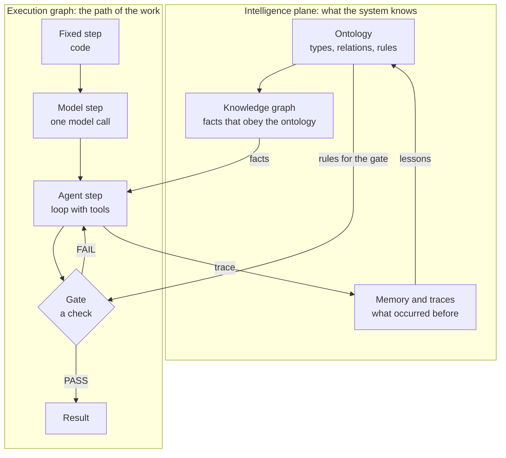
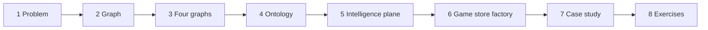

# GE 00 — Session Guide

> [!abstract] Purpose
> This set of notes teaches Graph Engineering to a developer. Read this note first. It gives the main idea, the plan, and the map.

## The main idea

An agent is a language model that uses tools in a loop. The model is probabilistic. Thus the same task can give different results.

You cannot remove the probability from the model. But you can put structure around the model. The structure makes the decisions that must not change.

> [!info] The idea in two sentences
> Put the structure outside the model. Then the model makes a smaller number of decisions, and the system makes the other decisions.

## The three controls

Three controls decrease the variation. All the notes use these three controls.

| Control | What it does | Tool | Note |
|---|---|---|---|
| 1 | A smaller number of decisions for the model | Execution graph | [GE 02 — Graph Engineering](ge-02-graph-engineering.md) |
| 2 | A smaller number of permitted results | Ontology and schema | [GE 04 — Ontologies](ge-04-ontologies.md) |
| 3 | A check before a result causes a change | Gate and verifier | [GE 02 — Graph Engineering](ge-02-graph-engineering.md), [GE 04 — Ontologies](ge-04-ontologies.md) |

The intelligence plane keeps the knowledge that the three controls use. It also uses the evidence of each run to make the controls better. Refer to [GE 05 — The Intelligence Plane](ge-05-the-intelligence-plane.md).

## The full system

Read the diagram from the bottom to the top:

1. The execution graph sets the path of the work. This is control 1.
2. The agent step gets its facts from the knowledge graph.
3. The ontology gives the permitted results. This is control 2.
4. The gate uses the rules of the ontology to accept or reject a result. This is control 3.
5. Each run writes a trace. The traces make the ontology and the knowledge graph better.

## One experiment through the full session

One small experiment connects the parts of the session.

| Part | What you do |
|---|---|
| 1 | Ask a model five times for the status of one order. Write the five results. |
| 4 | Put the five results into a validator. Count the results that the validator rejects. |
| 6 | See how the plan gate of the factory stops a status that is not permitted. |

The prompt is in [GE 01 — Why Agent Output Changes](ge-01-why-agent-output-changes.md). The validator is in [GE 04 — Ontologies](ge-04-ontologies.md), section 10.

## Session plan

Each note has core sections and reference sections. A reference section has "(reference)" in its title. Teach only the core sections in the session. The reference sections are for the days after the session.

| Part | Note | Core sections | 100 min | 60 min |
|---|---|---|---|---|
| 1 | [GE 01 — Why Agent Output Changes](ge-01-why-agent-output-changes.md) | 1 to 5 | 12 | 8 |
| 2 | [GE 02 — Graph Engineering](ge-02-graph-engineering.md) | 1 to 3, 7, 8, and the loan example in GE 03, section 5 | 20 | 12 |
| 3 | [GE 03 — Four Types of Graph](ge-03-four-types-of-graph.md) | 1 and 2 | 5 | 2 |
| 4 | [GE 04 — Ontologies](ge-04-ontologies.md) | 1, 5, 7, 10 | 18 | 12 |
| 5 | [GE 05 — The Intelligence Plane](ge-05-the-intelligence-plane.md) | 2, 3, 6, 10 | 10 | 5 |
| 6 | [GE 06 — Worked Example — Game Store Software Factory](ge-06-worked-example-game-store-software-factory.md) | All | 18 | 13 |
| 7 | [GE 07 — Case Study — Knowledge Graph for a Legacy Application](ge-07-case-study-knowledge-graph-for-a-legacy-application.md) | 2, 4, 5, 8 | 7 | 5 |
| 8 | [GE 08 — Glossary, Checklist and Exercises](ge-08-glossary-checklist-and-exercises.md) | Exercise 2 and section 7 | 10 | 3 |

For a 60-minute session, keep parts 6 and 7. Use less time for parts 1 to 5.

## Five claims

1. The model stays probabilistic. The system becomes predictable.
2. A graph decreases the number of decisions that the model makes.
3. An ontology gives the permitted results. A gate rejects each other result.
4. A gate rejects an incorrect result before the result causes a change.
5. Start with one loop. When a specific problem occurs, add structure.

## Structure of each note

- A purpose statement.
- Core sections and reference sections, with diagrams.
- A "Try it" box with one demonstration and one question.
- The sources.

## Language of these notes

These notes use the rules of ASD-STE100 Simplified Technical English:

- Short sentences. One topic for each paragraph.
- The active voice.
- One word for one meaning.
- American spelling.

The notes use many words from the STE dictionary. No person did a check of these notes with STE checker software.

### Technical names

These words are technical names of this subject:

> agent, model, harness, loop, graph, execution graph, knowledge graph, context graph, procedural graph, node, edge, relation, state, step, path, branch, run, gate, verifier, validator, checkpoint, budget, ontology, schema, constraint, enumeration, class, cardinality, entity, reasoner, meaning, semantic layer, token, trace, memory, skill, context, prompt, plane, tool, tool call, model call, query, script, register, policy, request, plan, claim, lesson, finding, review, audit, attempt, feedback, lint, baseline, closeout, workflow, repository, pull request, endpoint, software factory.

### Technical verbs

> validate, compile, parse, retrieve, classify, infer, enforce, extract, commit, deploy, merge, fine-tune, load, update, escalate, reason, reject.

### Rules for some words

- These words are nouns only: run, call, test, check, audit, review, plan, search, query, report.
- "Model" means a language model only.
- "Step" means one node of an execution graph, or one item of a procedure.
- "Path" is the word for the sequence of nodes in a run. The notes do not use "route".
- "Edge" is for an execution graph. "Relation" is for an ontology or a knowledge graph.
- PASS and FAIL are the two results of a check.
- The notes also use words for the lesson: learner, session, exercise, idea.

The code blocks, the diagrams and the titles of the sources are not STE text.

## How to give these notes to a different person

The notes use Obsidian links and images. Other applications do not show them correctly.

1. Export each note to PDF from Obsidian.
2. Send the PDF files.

If you send the Markdown files, also send the folder `11 - Attachments/Graph Engineering`.

## Sources

| # | Source | What it gives |
|---|---|---|
| 1 | [Everyone Has the Same AI Models. Here's What Sets Agents Apart](https://youtu.be/1_lX0m64-aI) — Richmond Alake, Oracle (AI Engineer talk) | The intelligence plane, memory, the governed agent demonstration |
| 2 | [Make Your AI Agents Predictable With Graph Engineering](https://youtu.be/g_NgCLTibiM) — Zachary Blumenfeld, Neo4j (AI Engineer talk) | Three types of graph, skills with the shape of a graph, the loan example |
| 3 | [Graph Engineering in the Era of LLM Agents](https://arxiv.org/abs/2608.21156) — Feng et al., arXiv 2608.21156, 2026 | The engineering ladder, the three views, Ontology Engineering |
| 4 | [Why Agentic Systems Need Ontologies](https://www.youtube.com/watch?v=Sir59K8ZDPU) — Frank Coyle, UC Berkeley (AI Engineer World's Fair) | Ontology basics, RDFS and OWL, the two gates |
| 5 | [3 Years of Graph Engineering with LangGraph](https://www.langchain.com/blog/3-years-of-graph-engineering-with-langgraph) — Runkle and Chase, LangChain, 2026 | Nodes and edges, when not to use a graph |
| 6 | [The Art of Loop Engineering](https://www.langchain.com/blog/the-art-of-loop-engineering) — Runkle, LangChain, 2026 | The four loops |
| 7 | [What Is Graph Engineering? Definition and Patterns](https://www.puppygraph.com/learn/graph-engineering) — Sa Wang, PuppyGraph, 2026 | Shapes, failure modes, the enforced ontology |
| 8 | [What is Graph Engineering? A Hands-On Guide to Multi-Agent Orchestration With LangGraph](https://www.datacamp.com/tutorial/graph-engineering-guide) — Josep Ferrer, DataCamp, 2026 | The loop or graph decision table, the ladder, LangGraph code |
| 9 | [Vectors and graphs: Better together](https://neo4j.com/blog/developer/vectors-graphs-better-together/) — Roie Schwaber-Cohen (Pinecone), Neo4j Developer Blog, 2024 | Vector search with a graph, ontology from metadata |

> [!note] The sources of the talks
> The notes use the official summary page, the description and the chapter list of each talk. They do not use a full transcript.

> [!note] Images
> The images in these notes come from the sources above. Each image has a source line. The images from source 3 have the license CC BY 4.0. The other images belong to their owners. They are for study only. Permission from the owner is necessary before publication.

---
Next: [GE 01 — Why Agent Output Changes](ge-01-why-agent-output-changes.md)
