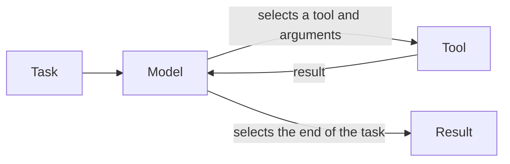
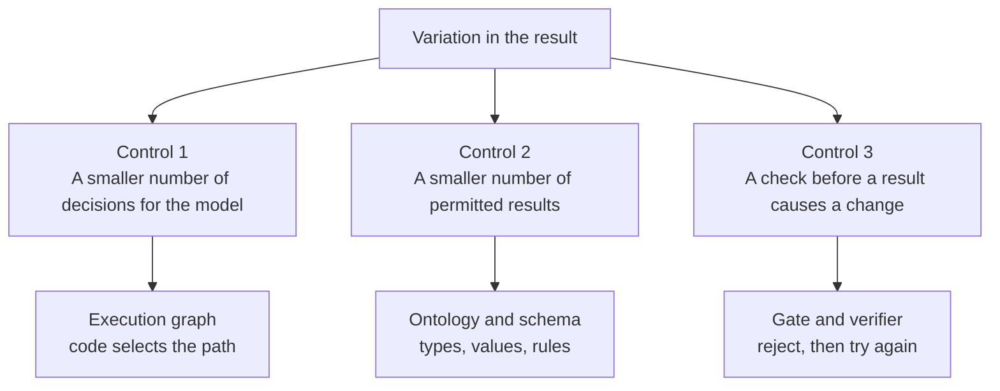

# GE 01 — Why Agent Output Changes

> [!abstract] Purpose
> This note shows the cause of the variation in agent output. It gives the three controls that decrease the variation. All the other notes use these three controls.

## 1. A model gives a probability

A language model calculates a probability for each possible next token. Then it selects one token. It does this again for each token of the result.

Thus the same input can give a different output. A low temperature decreases the variation. It does not remove the variation from a full system.

A developer frequently asks: "Why not set the temperature to zero?" There are three answers:

- A hosted model can give a different output with temperature zero. The supplier can also change the model.
- One different token at the start of a loop changes each step that comes after it.
- The tool results change between two runs, because the files and the data change.

> [!info] Key idea
> You cannot be sure that the model gives the same output each time. You can make the system around the model predictable.

## 2. An agent makes many decisions

An agent is a model that uses tools in a loop. In each turn of the loop, the model makes decisions. Each decision is a point where the result can change.



| Decision that the model makes | Example of an incorrect result |
|---|---|
| Which step is next | The agent writes code before it reads the repository |
| Which tool to use | The agent does a search of the web, but the answer is in the database |
| Which arguments to send | The agent sends the incorrect order number |
| What a term means | Two agents use two definitions of "active customer" |
| Which value is permitted | The agent writes the status "probably shipped" |
| When to stop | The agent stops too soon, or it does not stop |
| If the work is good | The agent gives approval to its own work |

A paragraph of instructions in a prompt does not reliably prevent these results. The model does not always obey an instruction.

## 3. The effect of small errors increases

Look at a task with a sequence of steps. Each step must be correct for the task to be correct.

If each step is correct with probability `p`, then `n` steps are all correct with probability `p^n`.

| Correct rate of one step | 5 steps | 10 steps | 20 steps |
|---|---|---|---|
| 99% | 95% | 90% | 82% |
| 95% | 77% | 60% | 36% |
| 90% | 59% | 35% | 12% |

> [!note]
> This calculation is correct only if the steps are independent. It is a simple calculation. It is not a measurement of a real agent.

The table gives two lessons:

- A long sequence of model decisions is not reliable, although each decision is good.
- If you remove decisions from the sequence, the full task becomes more reliable.

## 4. The three controls

There are three ways to decrease the variation. Each control is the answer to a different question.



| Control | Question | Tool | Note |
|---|---|---|---|
| 1. A smaller number of decisions | Is the model necessary for this decision? | Execution graph | [GE 02 — Graph Engineering](ge-02-graph-engineering.md) |
| 2. A smaller number of permitted results | Which results are valid? | Ontology, schema | [GE 04 — Ontologies](ge-04-ontologies.md) |
| 3. A check before a change | Is this result correct? | Gate, verifier | [GE 02 — Graph Engineering](ge-02-graph-engineering.md), [GE 04 — Ontologies](ge-04-ontologies.md) |

## 5. What "deterministic" means in these notes

The word "deterministic" can cause confusion. These notes use it for the system, not for the model.

| This stays probabilistic | This becomes fixed |
|---|---|
| The words of a result | The permitted paths of the work |
| The text of the code that an agent writes | The steps that must occur, and their sequence |
| The plan that an agent suggests | The values that a field can have |
| The text that an agent writes about its work | The checks for each result |
| | The point where a person must give approval |

The aim is a system that gives the same permitted paths, the same checks, and the same permitted values on each run.

### How to measure the variation

1. Do the same task ten times with the same input.
2. Record the path of each run.
3. Record the value of each typed field of each run.
4. Count the different paths and the different values.
5. Add one structure, then do steps 1 to 4 again.
6. Compare the two sets of numbers.

A smaller count shows that the system is more predictable. This measurement is about variation. It is not a measurement of quality.

## 6. The engineering ladder (reference)

The survey paper puts Graph Engineering near the top of a ladder of methods. The paper uses an examination as the analogy.

*(The image of the note is not in this repository. Its source is given below. The course shows a new drawing of the same content.)*
*Source: Feng et al., "Graph Engineering in the Era of LLM Agents", arXiv 2608.21156, Figure 4. License CC BY 4.0.*

| Level | Method | Analogy in the paper | What you control |
|---|---|---|---|
| 1 | Foundation model | An examination with no book | What the model knows |
| 2 | Prompt Engineering | Better instructions | The words of the request |
| 3 | Context Engineering | An examination with a book | The information that the model gets |
| 4 | Harness Engineering | You can use tools | Tools, memory, skills, external knowledge |
| 5 | Loop Engineering | Send, get feedback, try again | The cycle that continues until the task is complete |
| 6 | Graph Engineering | A team does the examination | The structure of the tasks, the agents and the runtime state |
| 7 | Ontology Engineering | One handbook for the team | The shared meaning of terms and rules |

The Analogy column is from the paper. The last column is a summary by these notes. For levels 2 to 6, the summary uses the ladder in the DataCamp guide.

The **harness** is the code around the model: the tools, the memory, the skills and the files.

The paper also gives a short formula for an agent:

```text
Agent = Loop(LLM + Harness)
```

The paper gives names to three levels of intelligence:

- **Model intelligence**: what one model can do in one model call.
- **Individual intelligence**: what one agent can do with a harness and a loop.
- **System intelligence**: what a system of agents can do when it has explicit structure.

Graph Engineering is the method for the third level. The paper gives Ontology Engineering as the future direction for this level.

### Use each level in sequence

Each level is the base for the next level. The DataCamp guide shows the result when a level is absent:

| Level | If the level is absent |
|---|---|
| Prompt | The model answers a question that you did not ask |
| Context | The model reasons correctly about the incorrect material |
| Harness | The model cannot change anything outside the chat window |
| Loop | The agent stops too soon, or it does not stop |
| Graph | One agent tries to do the work of four agents |

Before you add a graph, make one loop stable. Three nodes that are not reliable do not make a reliable system. They make a system with more points of failure.

> [!tip] Try it
> **Demonstration:** Start five new chats with a model. Give this prompt in each chat:
> "Order 1042: the payment is accepted. The email with the game key is in the send queue. Give the status of this order in two words at most."
> Write the five results on a board. Keep them for part 4 of the session.
> **Question:** "In your last agent task, which decisions did the model make that code can make?"

## Sources

- Feng et al., [Graph Engineering in the Era of LLM Agents](https://arxiv.org/abs/2608.21156), sections 1 and 3.
- Josep Ferrer, [What is Graph Engineering? A Hands-On Guide to Multi-Agent Orchestration With LangGraph](https://www.datacamp.com/tutorial/graph-engineering-guide), DataCamp, 2026, "The AI engineering ladder".

---
Previous: [GE 00 — Session Guide](ge-00-session-guide.md) · Next: [GE 02 — Graph Engineering](ge-02-graph-engineering.md)
