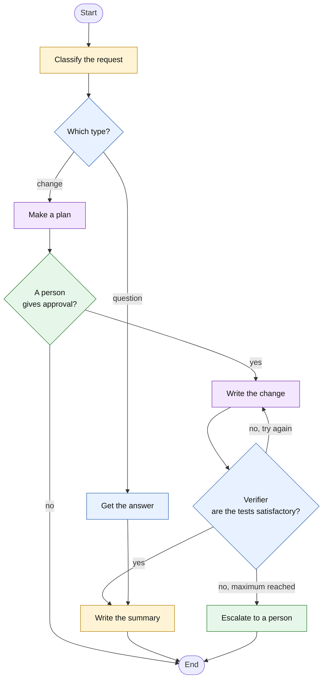

# GE 02 — Graph Engineering

> [!abstract] Purpose
> This note is about control 1: a smaller number of decisions for the model. It shows the parts of an execution graph. It also shows how a graph moves decisions from the model to code.

## 1. Definition

Graph Engineering is the design of the graph in which an agent system operates. These notes use the name **execution graph** for that graph.

- A **node** does one unit of work.
- An **edge** selects the next node.
- The **state** is the data that moves from node to node.

You can think of the graph as a state machine. The idea is not new. Workflow engines used it for many years. A model in a node is also not new. The LangChain article says that the new part is a full agent in a node.

> [!info] Key idea
> In a loop, the model selects its own path. In a graph, you select the permitted paths. The model reasons in a node, or it selects one permitted path.

## 2. The four parts

### 2.1 Nodes

A node is not always a model call. Give each node one responsibility.

| Type of node | What it contains | Predictable? |
|---|---|---|
| Fixed step | Code. No model. | Fully |
| Model step | One model call with no tools | Not fully |
| Agent step | A model that uses tools in a loop | Less than a model step |
| Verifier | A check of the work of a different node | Fully, if it is code |
| Person step | A person gives approval or rejects | Fully, as a point in the path |

The LangChain article shows one graph with the first three types of step.

*(The image of the note is not in this repository. Its source is given below. The course shows a new drawing of the same content.)*
*Source: Runkle and Chase, "3 Years of Graph Engineering with LangGraph", LangChain, 2026.*

This image uses its own colors. Read its legend.

> [!tip] A test for a node
> Write what the node does in one sentence with no "and". If you cannot do this, divide the node.

### 2.2 Edges

| Type of edge | Who selects the next node |
|---|---|
| Fixed edge | No one. Node B always comes after node A. |
| Conditional edge, by code | A function reads the state and gives the name of the next node. |
| Conditional edge, by model | A model reads the state and selects one of the permitted next nodes. |
| Fan-out | One node starts two or more nodes at the same time. |
| Fan-in | Parallel branches connect again at one node. |

Put the stop rules on the edges. The maximum number of attempts is a decision about the path. It is not a decision about the content.

### 2.3 State

The state is one object. Each node reads the state and writes to the state. The state is a contract between the nodes.

- Give each field a type.
- Give each field one owner. Only the owner writes the field.
- If parallel branches write the same field, write a merge rule for that field.

### 2.4 Control

A graph can operate for a long time. Failures during a run are usual.

- **Checkpoint**: record the state at the end of each node. Then a run can continue after a failure.
- **Budget**: set a maximum cost for each node and for the full run.
- **Terminal node**: give the nodes where the run stops.

After a failure, the node starts again from its first line. Thus make each node safe to do two times. This is most important for a node that opens a pull request or sends a payment.

## 3. An example graph



Legend: blue is code, yellow is one model call, purple is an agent, green is a person.

### The same task as one loop and as this graph

| Decision | In one loop | In this graph |
|---|---|---|
| Which step is next | The model | Code, on the edges |
| If a person must give approval | The model, if it obeys the prompt | The graph. The path goes through the person step. |
| If the tests are necessary | The model, if it obeys the prompt | The graph. The path goes through the verifier. |
| The number of attempts | The model | An edge with a maximum |
| The text of the plan and of the code | The model | The model |

The model keeps the last row only. Each other row is a decision that the model does not make.

## 4. A loop is a graph (reference)

A loop is a graph with a path that goes back to a node that came before. Thus Loop Engineering is one part of Graph Engineering.

*(The image of the note is not in this repository. Its source is given below. The course shows a new drawing of the same content.)*
*Source: Sa Wang, "What Is Graph Engineering? Definition and Patterns", PuppyGraph, 2026.*

The LangChain article about loops shows four loops, one around the other:

*(The image of the note is not in this repository. Its source is given below. The course shows a new drawing of the same content.)*
*Source: Runkle, "The Art of Loop Engineering", LangChain, 2026.*

| Loop | What it does |
|---|---|
| 1. Agent loop | The model uses tools until the task is complete |
| 2. Verification loop | A verifier examines the result. If the result is not satisfactory, the agent tries again with feedback. |
| 3. Event loop | An event starts the agent. For example: a message, a schedule, a webhook. |
| 4. Hill climbing loop | An analysis of the traces changes the prompts, the tools and the verifiers |

The article uses the name "grader" for the verifier of loop 2. In these notes, loop 4 is the base of the intelligence plane. The article does not use that term. Refer to [GE 05 — The Intelligence Plane](ge-05-the-intelligence-plane.md).

## 5. Usual shapes (reference)

*(The image of the note is not in this repository. Its source is given below. The course shows a new drawing of the same content.)*
*Source: Sa Wang, "What Is Graph Engineering? Definition and Patterns", PuppyGraph, 2026.*

In the image, a continuous line is a fixed transition. A dashed line is a transition that a model selects.

| Shape | Who selects the path | Use it when |
|---|---|---|
| Sequential pipeline | Code | You know the steps and their sequence |
| Routing | Model | Different inputs must go to different specialists |
| Fan-out and gather | Code | The parts are independent and can operate at the same time |
| Orchestrator and workers | Model | You cannot list the parts before the run |
| Evaluator and optimizer | Code or model | A different node must examine the work |
| Nested graph | Code | A full graph is one node in a larger graph |

For the last two rows, the column "Who selects the path" is an estimate by these notes. A path that code selects is easy to examine with a test.

## 6. The three views of a system (reference)

The survey paper divides Graph Engineering into three views. Each view is a graph.

*(The image of the note is not in this repository. Its source is given below. The course shows a new drawing of the same content.)*
*Source: Feng et al., arXiv 2608.21156, Figure 5. License CC BY 4.0.*

| View | Question | What the graph contains |
|---|---|---|
| Task organization | What work is necessary? | Subtasks, their sequence, workflows |
| Agent coordination | Who does the work? | What each agent can do, teams, communication |
| Runtime state management | What is the condition of the system now? | Recorded states, the location of faults, recovery |

A fourth topic connects the three views. **System evolution** uses the evidence from runs to change the structure.

## 7. How a graph makes a system predictable

| Mechanism | With one loop | With a graph |
|---|---|---|
| Fixed path | The model selects the sequence of steps | Code selects the sequence |
| Policy as structure | "Get approval" is a sentence in a prompt | Approval is a node. The run cannot go around it. |
| Independent verifier | The agent examines its own work | A different node examines the work |
| Maximum number of attempts | The agent can continue with no end | A node counts the attempts. An edge reads the count and stops the run. |
| State contract | Data is in the context window and one external location | Data is in typed fields with owners |
| Recorded path | One long transcript | A trace for each node and each edge |

> [!info] Key idea
> An instruction in a prompt is a suggestion. A node with an edge is a constraint.

### A before and after

The loan example in [GE 03 — Four Types of Graph](ge-03-four-types-of-graph.md), section 5, shows one task before and after a graph. With the graph, the same model used approximately half the time. The model did not change. Only the structure changed.

### Two results about quality

Two results in the sources show that structure can increase the quality of a result. They do not measure the variation between runs.

- The AlphaCodium paper (2024) gives 19% with one prompt and 44% with a flow of steps. The test used GPT-4 on the CodeContests validation set, with five attempts for each problem. The DataCamp guide gives these numbers.
- An Anthropic report shows that a lead agent with parallel agents did 90.2% better than one agent. The test was an internal research evaluation. The same report says that such systems use approximately 15 times the tokens of a chat. The PuppyGraph guide gives these numbers.

## 8. When to use a graph

The default is one loop with a strict verifier. When a specific problem occurs, add a graph.

| Question about the task | One loop is sufficient | Use a graph |
|---|---|---|
| Can you write the task as one instruction? | Yes | No. The task goes from one role to a different role. |
| Does each step use the same model and tools? | Yes | No. Some steps use a small model, some use a large model. |
| Are some steps independent? | No | Yes, and they can operate at the same time |
| Who makes the decision that the result is good? | A check in the loop, for example the tests | A node that did not write the result |
| What must occur after a failure of one step? | Try again | Isolate the failure. The other work continues. |
| Who must read the record of the path? | Only your team | A person outside the team must see which step occurred, and why |

One clear "yes" in the right column is sufficient.

Three good causes for a new node:

1. **Specialization**: the node uses a different model or different tools.
2. **Parallel work**: the branches are independent, and the decrease in time is important to a person.
3. **Independent verification**: a node that did not write the work examines the work.

### When not to use a graph

- The task is open. You cannot give its steps before the run. An example is general research. Use an agent harness for such a task.
- All the steps are code. Then a script is sufficient.
- Do not divide the work between parallel agents if all the agents use the same context.
- Do not divide the work between parallel agents if each subtask must have the results of the other subtasks.

The last two items are advice from Anthropic for systems with many agents. The PuppyGraph guide gives this advice.

## 9. Failure modes (reference)

| Failure | Cause | Prevention |
|---|---|---|
| Lost data, or an error at the merge | Two branches write the same field | One owner for each field, or a merge rule |
| High cost | Each new worker increases the number of tokens | A budget for each node. A maximum for fan-out. |
| An error goes to the next node | The next node cannot see that the input is incorrect | A verifier node that is different from the producer. One governed data specification for the nodes that read data. |
| It is difficult to do the run again | A model selects the path | Fixed edges where this is possible. Record each path decision. |
| Too much structure | A graph where one loop was sufficient | Start with the simplest shape |

## 10. A code example (reference)

This example uses LangGraph. `call_model`, `run_checks` and `notify_person` are placeholders. `run_checks` gives a list of problems.

```python
from typing import Literal, TypedDict
from langgraph.graph import END, START, StateGraph

MAX_ATTEMPTS = 2

class ChangeState(TypedDict):
    request: str                       # owner: the caller
    draft: str                         # owner: writer
    attempts: int                      # owner: writer
    verdict: Literal["pass", "fail"]   # owner: verifier
    problems: list[str]                # owner: verifier

def writer(state: ChangeState) -> dict:
    feedback = state.get("problems", [])                     # empty on the first attempt
    draft = call_model(state["request"], feedback)           # model step
    return {"draft": draft, "attempts": state.get("attempts", 0) + 1}

def verifier(state: ChangeState) -> dict:
    problems = run_checks(state["draft"])                    # fixed step: code
    return {"verdict": "fail" if problems else "pass", "problems": problems}

def escalate(state: ChangeState) -> dict:
    notify_person(state["request"], state["problems"])       # person step
    return {}

def route(state: ChangeState) -> Literal["writer", "escalate", "__end__"]:
    # The stop rule is on the edge, not in a prompt.
    if state["verdict"] == "pass":
        return END
    if state["attempts"] >= MAX_ATTEMPTS:                    # the writer ran MAX_ATTEMPTS times
        return "escalate"
    return "writer"

builder = StateGraph(ChangeState)
builder.add_node("writer", writer)
builder.add_node("verifier", verifier)
builder.add_node("escalate", escalate)
builder.add_edge(START, "writer")
builder.add_edge("writer", "verifier")
builder.add_conditional_edges(
    "verifier", route, {"writer": "writer", "escalate": "escalate", END: END}
)
builder.add_edge("escalate", END)
graph = builder.compile()

result = graph.invoke({"request": "Add a refund button"})
```

> [!tip] Try it
> **Demonstration:** Draw the graph of section 3 on a board with no colors. Give a color to each node: code, model, agent, or person.
> **Question:** "Which rule in your prompt is a suggestion that must be a node?"

## Sources

- Runkle and Chase, [3 Years of Graph Engineering with LangGraph](https://www.langchain.com/blog/3-years-of-graph-engineering-with-langgraph), LangChain, 2026.
- Runkle, [The Art of Loop Engineering](https://www.langchain.com/blog/the-art-of-loop-engineering), LangChain, 2026.
- Sa Wang, [What Is Graph Engineering? Definition and Patterns](https://www.puppygraph.com/learn/graph-engineering), PuppyGraph, 2026.
- Josep Ferrer, [What is Graph Engineering? A Hands-On Guide to Multi-Agent Orchestration With LangGraph](https://www.datacamp.com/tutorial/graph-engineering-guide), DataCamp, 2026.
- Feng et al., [Graph Engineering in the Era of LLM Agents](https://arxiv.org/abs/2608.21156), section 4.

---
Previous: [GE 01 — Why Agent Output Changes](ge-01-why-agent-output-changes.md) · Next: [GE 03 — Four Types of Graph](ge-03-four-types-of-graph.md)
