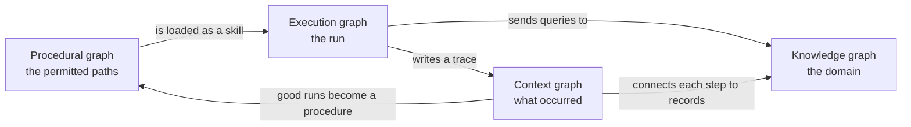
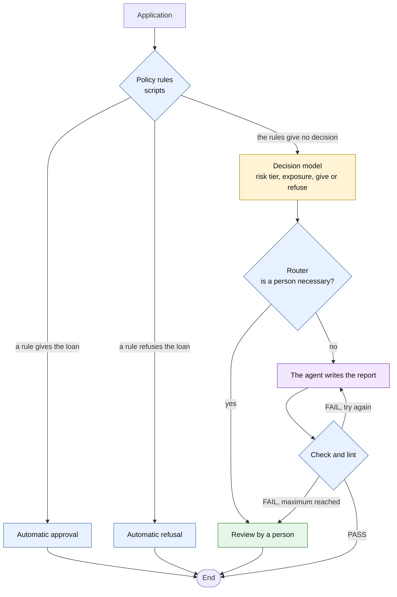
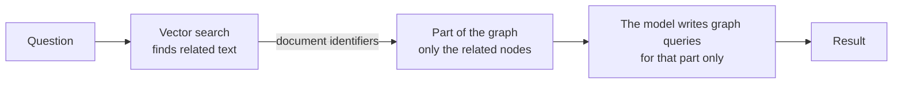

# GE 03 — Four Types of Graph

> [!abstract] Purpose
> The word "graph" has more than one meaning. This note gives the four meanings and shows how they connect. Section 5 has the loan example for control 1.

## 1. The four types

| Type | Question | Nodes are | Life |
|---|---|---|---|
| **Execution graph** | What comes next? | Units of work | The design is permanent. Each run is one pass through it. |
| **Knowledge graph** | What is in the domain? | Entities, for example a customer or a file | Continues across runs |
| **Context graph** | What occurred in this run? | Steps, tool calls, the records that the run used | Permanent. Each run adds a trace. |
| **Procedural graph** | Which paths are permitted for the task? | Steps of a procedure | Permanent. Many runs use it again. |

The Neo4j talk gives three types: execution, context and procedural. These notes add the knowledge graph from the PuppyGraph guide as a fourth type. The Life column is a summary by these notes.

The execution graph and the procedural graph are about control. The knowledge graph and the context graph are about data.

A procedural graph is data that a harness loads. An execution graph is code that the runtime enforces.

> [!note] Two possible causes of confusion
> GraphRAG and knowledge graphs are about data. Graph Engineering, in its narrow sense, is about control. A context graph is a graph of traces. It is not the context window of a model.

## 2. How the four types connect

Read the diagram as a cycle:

1. The run obeys a procedure.
2. The run reads facts from the knowledge graph.
3. The run writes its steps to the context graph.
4. Good runs become a better procedure.

## 3. Execution graph and knowledge graph (reference)

[GE 02 — Graph Engineering](ge-02-graph-engineering.md) shows the execution graph. The two graphs meet at one point: a node that reads data.

The execution graph selects when a node reads data. It cannot tell you if the query has a correct meaning. A query can give rows and be incorrect.

For example, the query can use a relation that is not in the business. The node gets rows. The edge sends the rows to the next node. The next node reasons about an incorrect result.

The PuppyGraph guide suggests one shared specification of the domain below all the nodes. PuppyGraph sells such a layer. This specification is an ontology. Refer to [GE 04 — Ontologies](ge-04-ontologies.md).

## 4. Context graph: the trace of a decision (reference)

A context graph keeps three types of memory together:

- The conversation.
- The entities in the conversation and in the records.
- The decision trace: the steps and the tool calls of the run.

With these relations, a reviewer can start at a question and find the run. Then the reviewer can go from one step back to the record that the step used.

A trace shows the cause of a decision only after the run. It does not control the next run. For control, a procedural graph is necessary.

## 5. Procedural graph: a skill with the shape of a graph

A **skill** is a text file with instructions for one type of task. The agent reads a paragraph and selects an action. That decision is probabilistic.

You can compile the skill into a graph:

- Each decision point becomes a node.
- Each instruction that code can do becomes a script.
- The model gets only the decisions for which judgment is necessary.

### The loan example

The talk by Zachary Blumenfeld shows an agent that gives or refuses a loan. The demonstration starts at [10:47](https://youtu.be/g_NgCLTibiM?t=647) in the [talk](https://youtu.be/g_NgCLTibiM).

The first version had the data graph and written instructions. The agent did the same review two times. One run found an older case, thus the two paths were different. The trace showed the cause of the difference only after the run.

An instruction to escalate when the agent is not sure gave that decision to the model. The model did not have calibrated confidence values.

The second version is a procedural graph:

The scripts use the policy rules first. The model makes a decision only when the rules give no decision. The maximum on the report cycle is an addition by these notes.

The talk gives these results for the demonstration:

- With the procedure, the same model used approximately half the time.
- With the paths in scripts, the team used a smaller model for the other work. This decreased the time and the cost more.
- The first version was also correct almost each time.

> [!note]
> These numbers come from a small number of demonstration runs. They are not a benchmark.

### Three gains

The talk gives three gains from graphs:

| Gain | Meaning |
|---|---|
| Predictable | The same type of case goes on the same path |
| Governable | The trace shows which rule or which model made a decision |
| Portable | A different harness can load the same skill and get the same paths |

### Permitted paths and actual paths

Keep the permitted paths and the actual paths together. Then you can answer two questions:

- Which rule or which model made the decision in this case?
- Which branch of the procedure did no run use?

A branch that no run used has no evidence from a real case.

## 6. Vectors and graphs together (reference)

A vector search finds text with almost the same meaning. A graph query goes along the relations between entities. The Neo4j article connects the two methods.

| Method | Strong point | Weak point in the article |
|---|---|---|
| Vector search | Finds related text quickly | Frequently does not find how the facts connect |
| Graph that a model makes | Shows the relations between entities | Can be inconsistent and difficult to query |

### Who makes the graph?

The article compares two ways to make a knowledge graph:

| Way | Result |
|---|---|
| The model extracts all entities and relations | The number of node types and relation types can increase with no control. Then queries through many relations become difficult. |
| The metadata of the data set gives the types | The number of types stays small. The article gives more useful queries as the result of one demonstration. It gives no measurement. |

The second way is possible only for a data set with good metadata.

> [!info] Key idea
> Constraints on the types can increase the number of useful queries. A smaller number of types gives a smaller number of queries that have no relation to the question.

This is the same lesson as [GE 04 — Ontologies](ge-04-ontologies.md): give the types first, then add the facts to the graph.

> [!tip] Try it
> **Demonstration:** Write the word "graph" on a board. Write what it means to you. Then draw the four types.
> **Question:** "Your agent has a skill file. Which sentences in it are decisions that a script can make?"

## Sources

- Zachary Blumenfeld, [Make Your AI Agents Predictable With Graph Engineering](https://youtu.be/g_NgCLTibiM), Neo4j, AI Engineer talk. Summary on the [talk page](https://ai.engineer/talks/g_NgCLTibiM-make-your-ai-agents-predictable-graph-engineering).
- Sa Wang, [What Is Graph Engineering? Definition and Patterns](https://www.puppygraph.com/learn/graph-engineering), PuppyGraph, 2026, "Execution graphs versus knowledge graphs".
- Roie Schwaber-Cohen (Pinecone), [Vectors and graphs: Better together](https://neo4j.com/blog/developer/vectors-graphs-better-together/), Neo4j Developer Blog, 2024.

---
Previous: [GE 02 — Graph Engineering](ge-02-graph-engineering.md) · Next: [GE 04 — Ontologies](ge-04-ontologies.md)
