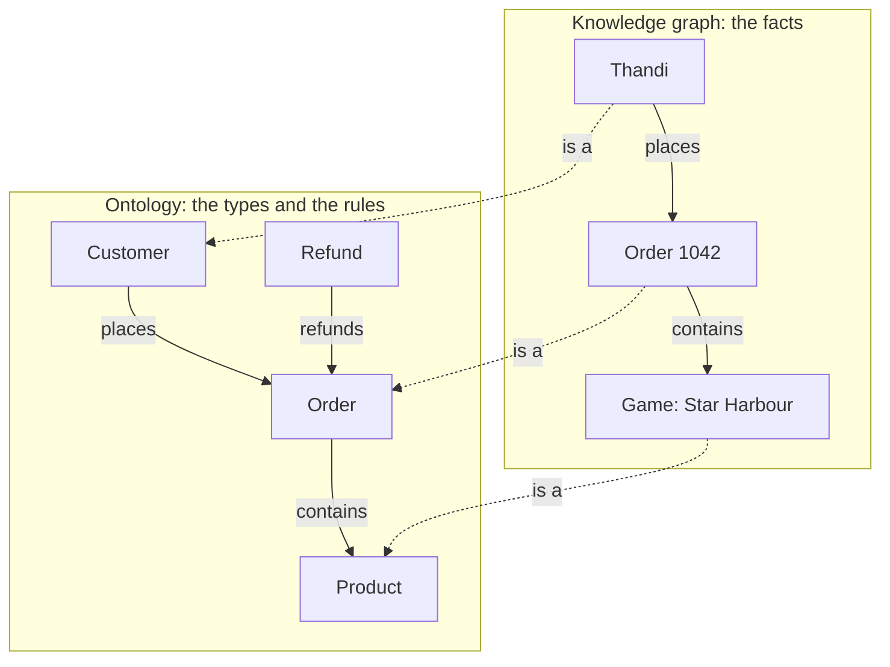
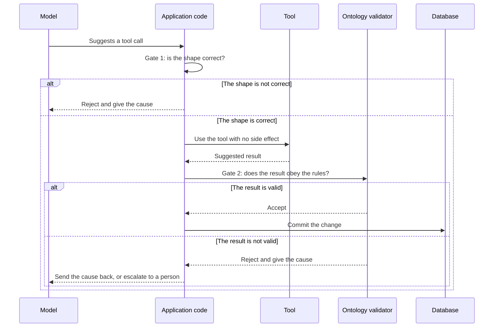
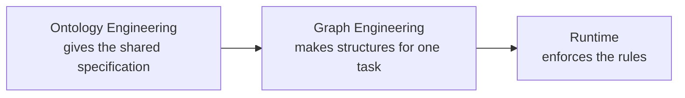

# GE 04 — Ontologies

> [!abstract] Purpose
> This note is about control 2 and control 3. An ontology gives the permitted results. A gate uses the ontology to reject a result that is not permitted.

## 1. Definition

An ontology is a formal specification of a domain. All parts of a system share this specification. It contains four things:

| Part | Example |
|---|---|
| Types of things (classes) | Customer, Order, Product, Refund |
| Properties | An order has a status and a total |
| Relations | A customer places an order |
| Constraints and rules | An order can have only one refund |

A person and a machine can read an ontology. That is the difference between an ontology and a paragraph in a prompt.

### Related terms

| Term | Meaning |
|---|---|
| Taxonomy | A tree of types. It has only the relation "is a type of". |
| Schema | The structure of data in one database or one message |
| Ontology | The types, relations and rules of a domain. It is independent of one database. |
| Knowledge graph | The facts about real things. The facts obey the ontology. |



## 2. Two traditions (reference)

Frank Coyle shows an agent system as two traditions that come together.

| Tradition | What it does |
|---|---|
| The agent (neural) | It suggests what is probable |
| The ontology (symbolic) | It declares what is permitted |

The name for the combination is **neurosymbolic AI**. In the design of Coyle, the model reasons with probability. Logic sets the limits around the model.

> [!info] Key idea
> The model suggests a result. The ontology rejects each result that is not permitted.

## 3. How to make an ontology (reference)

*(The image of the note is not in this repository. Its source is given below. The course shows a new drawing of the same content.)*
*Source: [Why Agentic Systems Need Ontologies](https://youtu.be/Sir59K8ZDPU?t=521), Frank Coyle, AI Engineer World's Fair 2026, at 8:41.*

The slide gives two approaches: top-down and bottom-up. Use them together. Also use the vocabularies that are available.

| Approach | Method |
|---|---|
| Top-down | Domain experts give the entities, properties, relations and constraints |
| Bottom-up | You extract entities and relations from documents, reviews and customer conversations |
| Available vocabularies | You use a public vocabulary, for example Schema.org, Dublin Core, FIBO or GoodRelations |

## 4. Inference and constraints (reference)

A graph with names is useful. A graph with rules is more useful. Three W3C standards add the rules: RDFS, OWL and SHACL.

*(The image of the note is not in this repository. Its source is given below. The course shows a new drawing of the same content.)*
*Source: [Why Agentic Systems Need Ontologies](https://youtu.be/Sir59K8ZDPU?t=666), Frank Coyle, at 11:06.*

### RDFS infers

With RDFS, you declare the domain and the range of a relation. Then a reasoner infers new facts.

```turtle
:teaches  rdfs:domain  :Teacher ;
          rdfs:range   :Student .
:Teacher  rdfs:subClassOf  :Person .

:bob  :teaches  :scooter .

# The reasoner infers:
#   :bob      a  :Teacher .
#   :bob      a  :Person .
#   :scooter  a  :Student .
```

### OWL adds exact rules

| OWL rule | Meaning | Example |
|---|---|---|
| Transitive property | The relation continues through a sequence | If A is an ancestor of B, and B of C, then A is an ancestor of C |
| Functional property | The relation has one value at most | An order has one customer |
| Disjoint classes | A thing cannot be in the two classes | A customer is not a staff member |
| Enumeration (`oneOf`) | The class has a fixed list of members | A status is paid, shipped or refunded |

```turtle
:Customer     a owl:Class .
:StaffMember  a owl:Class ;  owl:disjointWith  :Customer .

:placedBy     a owl:ObjectProperty , owl:FunctionalProperty ;
              rdfs:domain :Order ;  rdfs:range :Customer .

:OrderStatus  a owl:Class ;  owl:oneOf ( :Paid :Shipped :Refunded ) .

:status       a owl:ObjectProperty , owl:FunctionalProperty ;
              rdfs:domain :Order ;  rdfs:range :OrderStatus .
```

> [!note] OWL does not reject data
> OWL uses the open-world assumption. In OWL, two names can be one thing. If an order has two refunds, a reasoner infers that the two refunds are the same thing. It gives no error. SHACL or code gives a strict check of data.

### SHACL validates

A SHACL shape for the status rule, the customer rule and the refund rule:

```turtle
:OrderShape a sh:NodeShape ;
    sh:targetClass :Order ;
    sh:property [ sh:path :status ;
                  sh:in ( :Paid :Shipped :Refunded ) ;
                  sh:minCount 1 ;  sh:maxCount 1 ] ;
    sh:property [ sh:path :placedBy ;
                  sh:class :Customer ;
                  sh:minCount 1 ;  sh:maxCount 1 ] ;
    sh:property [ sh:path :hasRefund ;  sh:maxCount 1 ] .

:CustomerShape a sh:NodeShape ;
    sh:targetClass :Customer ;
    sh:not [ sh:class :StaffMember ] .
```

RDF is not necessary at the start. An enumeration in code and a small validator function are sufficient for a first version.

## 5. The two gates

Coyle puts two gates around each tool call in the agent loop.

*(The image of the note is not in this repository. Its source is given below. The course shows a new drawing of the same content.)*
*Source: [Why Agentic Systems Need Ontologies](https://youtu.be/Sir59K8ZDPU?t=1104), Frank Coyle, at 18:24.*

```text
while the task is not complete:
    proposal = the model suggests a tool call
    # GATE 1: is the shape of the call correct?
    result = the tool makes a result, with no change to data
    # GATE 2: does the result obey the ontology?
    record the change, or send the cause back to the model
```

| Gate | When | What it examines | Tool |
|---|---|---|---|
| Gate 1: input | Before the tool operates | The shape of the call: types, ranges, necessary fields | Pydantic |
| Gate 2: output | After the tool operates | The sense of the result: cardinality, roles, agreement with the state of the world | The ontology |
| The rule | During the loop | The agent calculates and gives a result. It does not change the world. | A pure agent |

Gate 1 reads only the call. Gate 2 reads the call, the result, the ontology and the current facts.

A fixed list of values is part of the ontology. Gate 1 can also use that list, if you make the schema from the ontology. Keep the list in one location only.

The third row is important. If the agent does not change data during the loop, you can reject a result and lose nothing. Do the Gate 2 check and the commit in one transaction. Add a unique constraint in the database for each cardinality rule.



### Errors that the gates stop

These three errors are difficult to stop with English instructions. Each one is some lines of logic.

| Error | Rule | Where to do the check |
|---|---|---|
| A second refund on the same order | Cardinality: an order has one refund at most | SHACL or code, at Gate 2 |
| A payment to a staff member, not to the customer | Role: the payee is the customer of the order | Code, at Gate 2 |
| The status "probably shipped" | Enumeration: the status is one of three values | SHACL or code, at Gate 2 |

### A code example

`plan_refund`, `send_back_to_model`, `commit`, `transaction` and `load_order_for_update` are placeholders.

```python
from pydantic import BaseModel, ConfigDict, PositiveInt, ValidationError

class RefundCall(BaseModel):                          # Gate 1: the shape of the input
    model_config = ConfigDict(extra="forbid", strict=True)
    order_id: PositiveInt
    amount_cents: PositiveInt
    payee_id: PositiveInt
    new_status: str

ALLOWED_STATUS = {"PAID", "SHIPPED", "REFUNDED"}      # from the ontology

def ontology_check(order, proposed) -> list[str]:     # Gate 2: the sense of the result
    problems = []
    if proposed.status not in ALLOWED_STATUS:
        problems.append(f"Status {proposed.status} is not in the ontology.")
    if order.refund_count >= 1:
        problems.append("An order can have only one refund.")
    if proposed.payee_id != order.customer_id:
        problems.append("The payee must be the customer who placed the order.")
    return problems

def handle(model_proposal) -> None:
    try:
        call = RefundCall.model_validate(model_proposal)
    except ValidationError as error:
        send_back_to_model([str(error)])              # Gate 1 rejects and gives the cause
        return
    proposed = plan_refund(call)                      # pure: no write to the database
    with transaction():                               # the check and the commit are one unit
        order = load_order_for_update(call.order_id)  # lock the order
        problems = ontology_check(order, proposed)
        if not problems:
            commit(proposed)                          # the only step with a side effect
    if problems:
        send_back_to_model(problems)                  # or escalate to a person
```

## 6. One ontology below all the nodes (reference)

In a graph, many nodes read data. If each node has its own specification of the data, the specifications become different.

*(The image of the note is not in this repository. Its source is given below. The course shows a new drawing of the same content.)*
*Source: Sa Wang, "What Is Graph Engineering? Definition and Patterns", PuppyGraph, 2026.*

The PuppyGraph guide gives two results of one enforced ontology:

- All the nodes use one contract. They do not use separate specifications.
- A rejected query is a signal. An edge can use that signal to send the work back.

## 7. Where an ontology decreases the variation

An ontology can act at three points. Only the second and the third are constraints.

| Point | What occurs | Is it a constraint? |
|---|---|---|
| Before the model call | The model sees the permitted values in its context | No. This is help for the model. |
| During the model call | A schema sets the output. The model can give only a value from the list. | Yes |
| After the model call | A gate examines the result. An incorrect value does not go to the next step. | Yes |

When a gate rejects a result, the cost is one more model call.

### Five mechanisms

| # | Mechanism | Effect |
|---|---|---|
| 1 | Closed vocabulary | A value that is not in the list does not go to the next step |
| 2 | Typed relations | A relation between two incorrect types does not go to the next step |
| 3 | Cardinality | A gate rejects a second item when one item is the maximum |
| 4 | Shared meaning | All agents use the same definition of a term |
| 5 | Smaller search space | A smaller number of types gives more useful queries and a smaller number of unrelated queries |

A sixth effect is feedback. When a gate rejects a result and gives the cause, the model knows what to correct.

> [!info] Key idea
> A prompt asks the model to obey a rule. An ontology makes the rule a check for each result.

## 8. Ontology Engineering: the next level (reference)

The survey paper gives Ontology Engineering as the future direction after Graph Engineering.

A graph makes the relations explicit. But the agents can disagree about the meaning of terms. For example:

- What is "task complete"?
- What is sufficient evidence?
- Which action has authorization?

An ontology for an agent system gives these shared concepts: goals, agents, capabilities, evidence, policies, states and outcomes.



The paper recommends a hybrid method for changes to the ontology:

- A model suggests a change and gives its cause.
- Reasoners, validators, tests, version control and people accept or reject the change.

## 9. Limits (reference)

- An ontology gives consistent meaning. It does not make a fact correct. Connect each fact to a source.
- An ontology has a maintenance cost. The domain changes, and the ontology must change with it.
- A large ontology is not better. Include only the concepts that are necessary for a decision.
- Rules that are too strict stop valid work. Start with the rules that prevent the errors with the highest cost.

## 10. Procedure: make your first ontology

1. Write the ten most important nouns of the domain.
2. For each noun, write its properties and their types.
3. Write the relations between the nouns as "subject, verb, object".
4. For each field with a fixed list of values, write the list.
5. For each relation, write the cardinality: one, or many.
6. Write the three errors with the highest cost. Write one rule for each error.
7. Put the lists and rules in code: enumerations, a schema, a validator function.
8. Use the validator at Gate 2, before each change to data.
9. When a new type of error occurs, add a rule.

### A validator for the session experiment

```python
ALLOWED_STATUS = {"CART", "PAID", "FULFILLED", "REFUNDED", "CANCELLED"}

def validate_status(value: str) -> str:
    status = value.strip().upper().replace(" ", "_")
    if status in ALLOWED_STATUS:
        return f"PASS  {status}"
    return f"FAIL  {value!r} is not in the ontology. Permitted: {sorted(ALLOWED_STATUS)}"

results = [
    # Put the five results from part 1 here.
    "Awaiting delivery", "Paid", "Processing", "Pending shipment", "Paid",
]
for result in results:
    print(validate_status(result))
```

> [!tip] Try it
> **Demonstration:** Put the five results from part 1 into the validator above. Count the results that the validator rejects. The correct status of order 1042 is `PAID`.
> **Question:** "Which three errors in your domain have the highest cost? Can you write each one as a rule?"

## Sources

- Frank Coyle, [Why Agentic Systems Need Ontologies](https://www.youtube.com/watch?v=Sir59K8ZDPU), UC Berkeley, AI Engineer World's Fair 2026. Summary on the [talk page](https://ai.engineer/talks/Sir59K8ZDPU-ontologies-for-agentic-systems).
- Feng et al., [Graph Engineering in the Era of LLM Agents](https://arxiv.org/abs/2608.21156), sections 5 and 6.1.
- Sa Wang, [What Is Graph Engineering? Definition and Patterns](https://www.puppygraph.com/learn/graph-engineering), PuppyGraph, 2026, "Grounding the nodes on a semantic data layer".
- Roie Schwaber-Cohen (Pinecone), [Vectors and graphs: Better together](https://neo4j.com/blog/developer/vectors-graphs-better-together/), Neo4j Developer Blog, 2024.

---
Previous: [GE 03 — Four Types of Graph](ge-03-four-types-of-graph.md) · Next: [GE 05 — The Intelligence Plane](ge-05-the-intelligence-plane.md)
