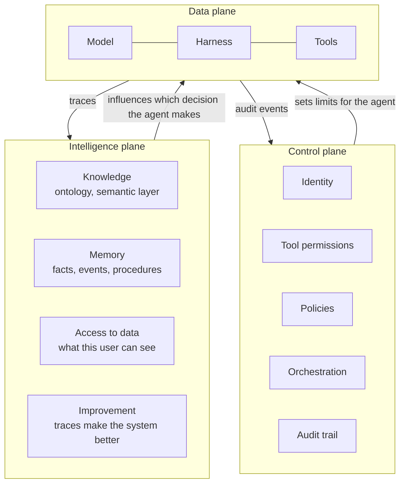
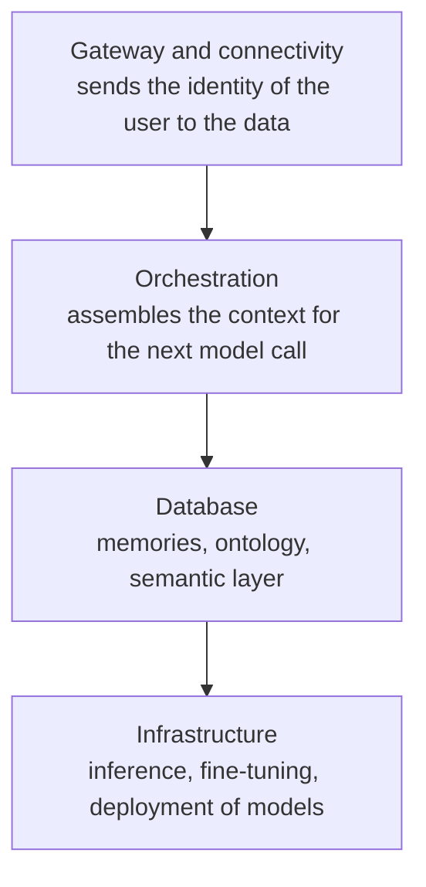
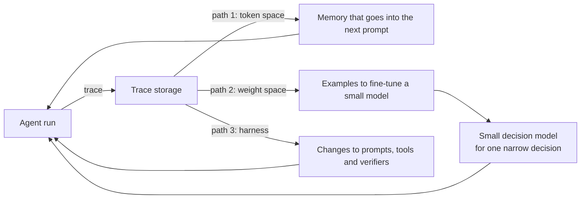

# GE 05 — The Intelligence Plane

> [!abstract] Purpose
> The intelligence plane is the layer that keeps the knowledge of an agent system. The three controls get their rules and their facts from this layer. This note shows its parts.

## 1. All teams have the same models

All teams can buy access to the same models. Thus the model is not the difference between two agent systems. The difference is what each system knows about its own domain.

Richmond Alake gives a story from the Second World War in his [talk](https://youtu.be/1_lX0m64-aI?t=278). Two groups had the same intercepted messages. One group kept paper records of old messages for months. That group found that the letters "AF" meant Midway. The other group did not find this.

> [!info] Key idea
> To have a message is not the same as to know its meaning. The recorded experience gives the meaning.

## 2. The planes

The word "plane" comes from network engineering. A plane is a layer of a system with one responsibility.

The talk gives two planes: the control plane and the intelligence plane. These notes add the data plane as a name for the agent runtime.

| Plane | Responsibility | Examples |
|---|---|---|
| Data plane | Does the work | The agent runtime, the model calls, the tool calls |
| Control plane | Manages the agents | Identity, tool permissions, policies, orchestration, audit trail |
| Intelligence plane | Keeps the knowledge | Ontology, semantic layer, memory, traces, improvement |

The control plane and the intelligence plane do different work:

- The control plane sets limits for the agent.
- The intelligence plane influences which decision the agent makes in those limits.

### Where the parts of these notes are

| Part | Plane |
|---|---|
| Agent step, model call, tool call | Data plane |
| Execution graph, maximum values, approval, tool permissions | Control plane |
| Ontology, knowledge graph, memory, traces, access to data | Intelligence plane |

The control plane operates the gate. The intelligence plane supplies the rules that the gate uses.

Access to data is in the intelligence plane, because it sets what the agent can know.

## 3. The four questions

The intelligence plane answers four questions.

| Question | Where you can put the answer (a summary by these notes) |
|---|---|
| What must the agent know? | The database: an ontology and a semantic layer |
| What must the agent keep in memory? | The memory manager and its storage |
| Which data can the agent see for this user? | The gateway and the data layer |
| How does one run make the next run better? | The traces, and the infrastructure that fine-tunes and deploys models |

## 4. Where the intelligence plane is in the stack (reference)

The intelligence plane is not one product. Its responsibilities go across the layers of the stack.

## 5. Memory (reference)

A memory system does four things. Alake gives them the name "the four Rs": retain, reuse, recall and refine.

| Type of memory | What it holds | Example |
|---|---|---|
| Semantic | Facts | "A refund is possible only for a paid order" |
| Episodic | What occurred | "On Monday the agent corrected defect 12 with this change" |
| Procedural | How to do a task | A skill, a procedure, a graph of steps |
| Working | Information for the current task | The files that are open now |

Procedural memory connects to [GE 03 — Four Types of Graph](ge-03-four-types-of-graph.md). A procedural graph is procedural memory with an explicit structure.

## 6. Ontology and semantic layer

These two parts answer different questions.

| Part | Question | Example |
|---|---|---|
| Ontology | What is this thing, and what are its relations to other things? | The ontology says what a counterparty is in this domain |
| Semantic layer | What is the exact meaning of this business term? | "Concentration" has one written definition in this company |

The definitions in these examples are not from the talk.

### The demonstration

The talk compares two analyst agents. They get the same questions.

| | Naive agent | Governed agent |
|---|---|---|
| Has the ontology | No | Yes |
| Has the semantic definitions | No | Yes |
| Other parts | Not given | Guard controls and prompt caching |
| Correct answers in the talk | Not given | 99% |
| Tokens in the talk | 200,000 | 32,000 |

> [!note]
> These numbers are from one demonstration with all the parts together. The talk summary does not give the number of questions or the method for the score. It does not give the decrease from each part. The numbers are an example, not a benchmark.

The demonstration gives one important lesson. A search result is not an answer. The naive agent found the records with a keyword search. But it did not know the meaning of the records.

> [!info] Key idea
> Do one test for retrieval and a different test for interpretation. An agent can find the correct record and give the incorrect answer.

## 7. Access: which permissions? (reference)

An agent acts for a person. Give the agent only the permissions that are necessary for the task. Never give more than the person has.

- Permission to use a database tool is one decision.
- Permission to read one row is a different decision.

Send the identity of the user through the agent to the data layer. Then the database gives only the rows that the user can see.

## 8. Improvement: three paths (reference)

Each run writes a trace. A trace can make the system better on three paths. The talk gives the first two.

| Path | What changes | Example |
|---|---|---|
| Token space | The input of the model | A lesson from an old run goes into the context |
| Weight space | The model | A small model learns where to put a new memory |
| Harness | The prompts, the tools and the verifiers | An analysis of traces adds a new check |

The LangChain article gives this cycle the name "hill climbing loop". Its first target is the harness: prompts, tools and verifiers. The article says that the same loop can also change memory, skills and model weights.

The survey paper says that persistent system evolution is rare. Most systems adapt their work in a fixed structure. A small number of systems change the structure permanently from the evidence of many runs.

## 9. The software factory (reference)

A **software factory** uses workflows that you can do again and again to make software. Frequently, two or more agents operate in parallel. Alake says that the factory idea started with work at General Electric in 1968.

A software factory uses the three planes of section 2:

| Plane | In a software factory |
|---|---|
| Data plane | The agents that write plans and code, and do tests and reviews |
| Control plane | Who can write to which branch, which steps must have approval from a person, the audit trail |
| Intelligence plane | The domain ontology, the knowledge graph of the code, the decisions, the lessons |

A control plane and a factory make the work reliable. They do not tell the agent the meaning of a term in your business. The intelligence plane does that.

[GE 06 — Worked Example — Game Store Software Factory](ge-06-worked-example-game-store-software-factory.md) shows a design.

## 10. A small intelligence plane

A large platform is not necessary at the start. One developer can make a small intelligence plane with files.

| Responsibility | A small version |
|---|---|
| Knowledge | Markdown notes with types and relations |
| Ontology | A fixed list of note types, relation types and status values |
| Memory | A decisions register, a lessons register, a defects register |
| Access | A deny rule in the harness that prevents the read of each protected note |
| Improvement | A closeout step that updates the notes at the end of each agent session |
| Checks | Scripts that validate the notes and the code |

[GE 07 — Case Study — Knowledge Graph for a Legacy Application](ge-07-case-study-knowledge-graph-for-a-legacy-application.md) shows how one developer uses this version.

## 11. What a team can do now (reference)

1. Write the entities and the definitions of the domain.
2. Put the access rules in the data layer.
3. Record a trace of each run.
4. Give each recorded trace a purpose: memory for a request that comes after, or training of a model.

> [!tip] Try it
> **Demonstration:** Find a term that has a special meaning in your company. Ask a model for the meaning with no context. Compare the result with the meaning in your company.
> **Question:** "If your team and a competitor use the same model, what does your system know that their system does not know?"

## Sources

- Richmond Alake, [Everyone Has the Same AI Models. Here's What Sets Agents Apart](https://youtu.be/1_lX0m64-aI), Oracle, AI Engineer talk. Summary on the [talk page](https://ai.engineer/talks/1_lX0m64-aI-everyone-has-same-ai-models-heres-what).
- Runkle, [The Art of Loop Engineering](https://www.langchain.com/blog/the-art-of-loop-engineering), LangChain, 2026, "Level 4: Hill climbing loop".
- Feng et al., [Graph Engineering in the Era of LLM Agents](https://arxiv.org/abs/2608.21156), sections 4.5 and 9.7.

---
Previous: [GE 04 — Ontologies](ge-04-ontologies.md) · Next: [GE 06 — Worked Example — Game Store Software Factory](ge-06-worked-example-game-store-software-factory.md)
