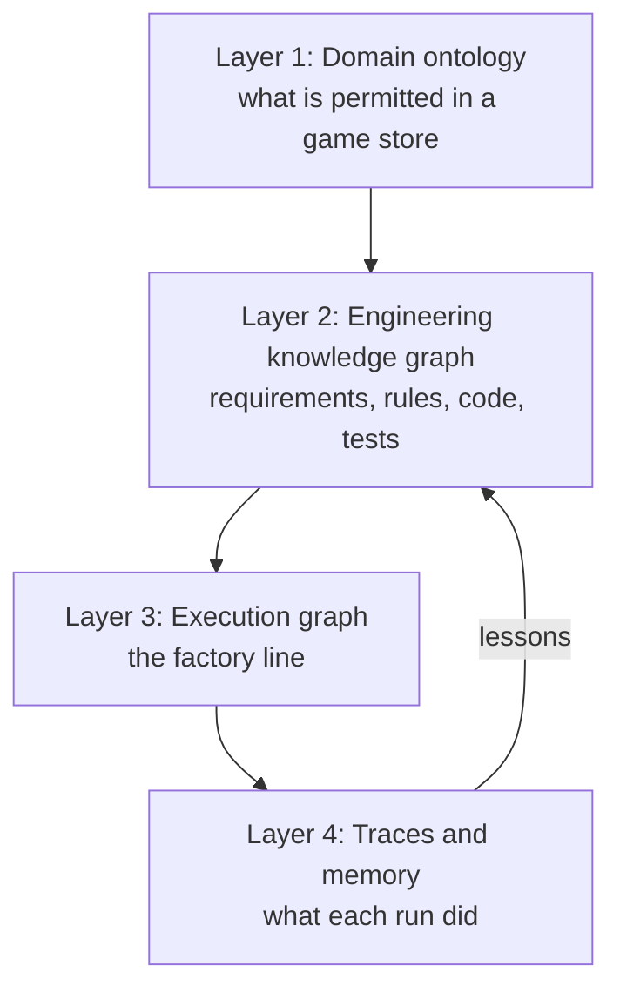
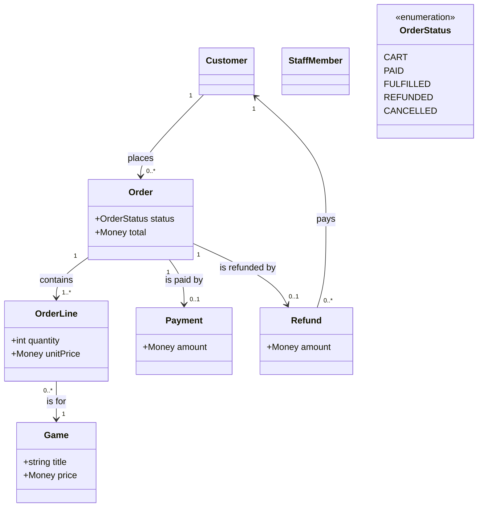
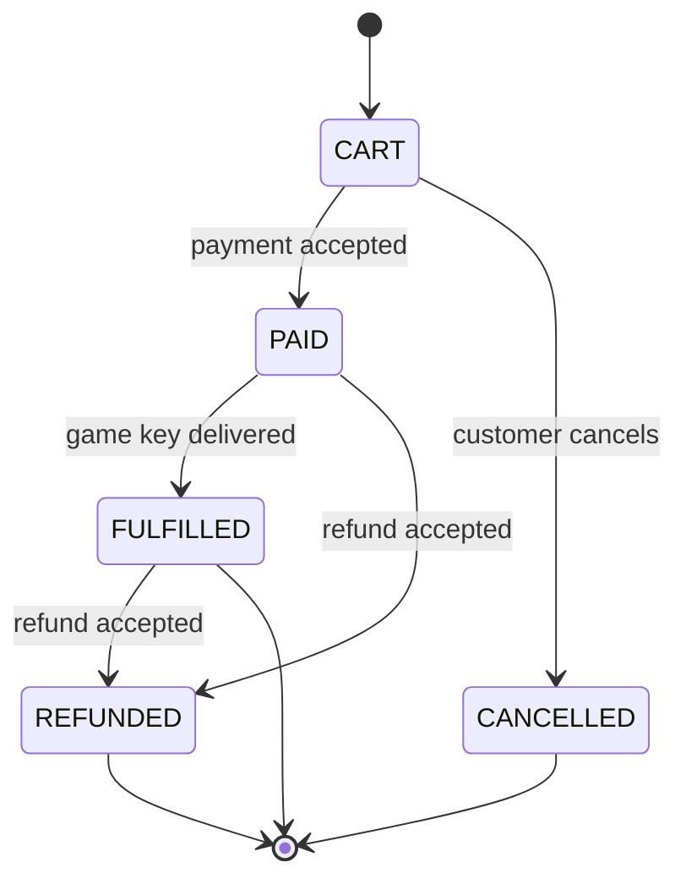
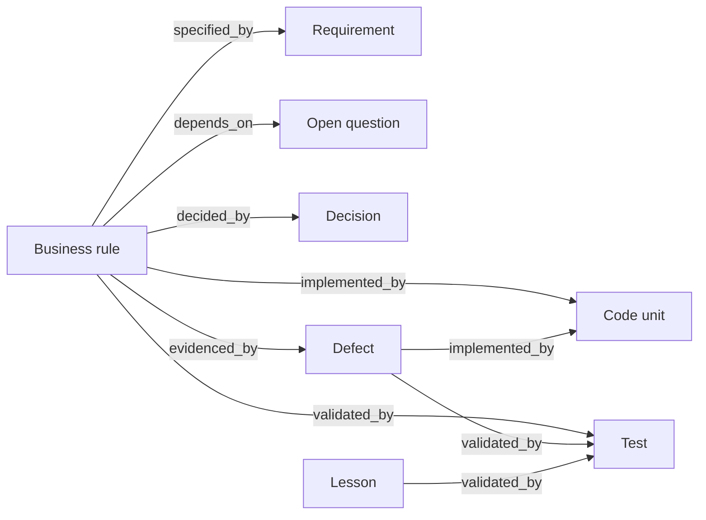
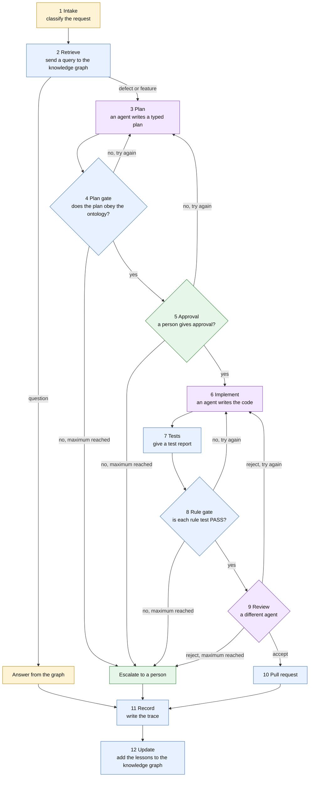
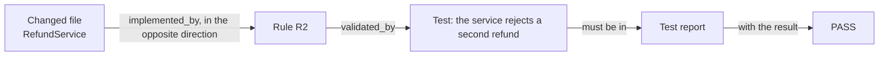
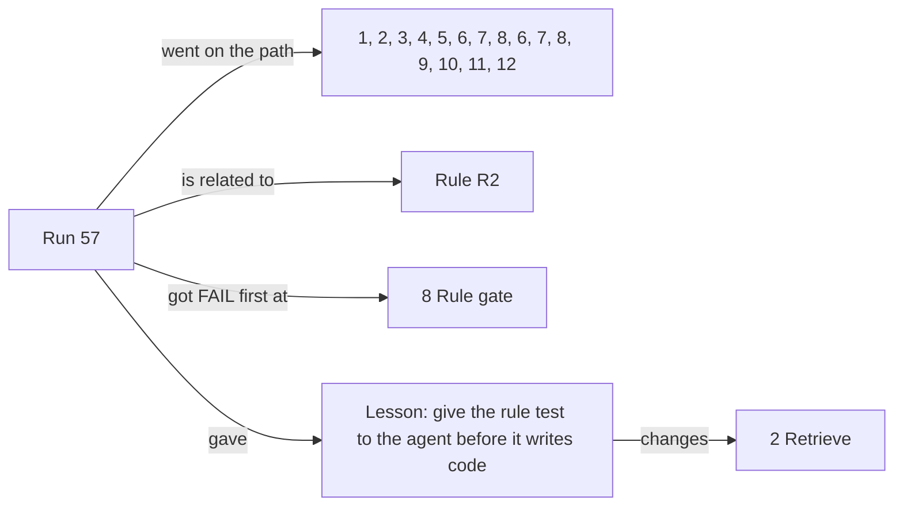

# GE 06 — Worked Example — Game Store Software Factory

> [!abstract] Purpose
> This note uses the three controls in one design. The design is a software factory for a game store application.

> [!note]
> This is a design for study. The system in this design is not in operation. The names and the rules are examples.

## 1. The aim

A **software factory** is a workflow that you can do again and again to make software. Agents do the steps for which judgment is necessary. Code does the other steps.

The factory in this note gets a change request. It gives a change that has test results and a review. The application is a game store with a catalog, a cart, orders, payments and refunds.

The factory must give these results on each run:

- A permitted path of the graph, and no other path.
- No value that is not in the domain.
- No change that does not obey a business rule.
- A record that shows the cause of each decision.

## 2. The four layers of the design

| Layer | Control |
|---|---|
| 1 and 2 | Control 2: a smaller number of permitted results |
| 3 | Control 1: a smaller number of decisions for the model |
| The gates in layer 3 | Control 3: a check before a change |
| 4 | The improvement of the three controls |

## 3. Layer 1: the domain ontology

The domain ontology gives the things in a game store.

### The constraints

The diagram gives the types and the relations. These rules complete the ontology:

| ID | Rule | Type of rule |
|---|---|---|
| R1 | The status of an order is one of five values | Enumeration |
| R2 | An order has one refund at most | Cardinality |
| R3 | A refund pays the customer who placed the order | Typed relation |
| R4 | A customer is not a staff member | Disjoint classes |
| R5 | The amount of a refund is not more than the amount of the payment | Value constraint |
| R6 | A price is not negative | Value constraint |
| R7 | The status changes only along a permitted transition | State transition |
| R8 | A refund is possible only for an order that has a payment | Cardinality |

### The permitted transitions

The order in the session experiment has an accepted payment. The customer does not have the game key. Thus its status is `PAID`. The status "Pending shipment" is not in rule R1. A change from `CART` to `REFUNDED` is not in rule R7. The validator rejects the two changes.

## 4. Layer 2: the engineering knowledge graph

A specification of the software work is also necessary. This second ontology has its own types and relations.

The knowledge graph holds the facts. For example:

| Node | Relation | Node |
|---|---|---|
| Rule R2 "one refund at most" | specified_by | Requirement "Refunds" |
| Rule R2 | implemented_by | `RefundService.createRefund` |
| Rule R2 | validated_by | Test "the service rejects a second refund" |

With this graph, an agent does not do a search of the full repository. It starts at the rule and goes along the relations to the code and the tests.

> [!info] Key idea
> The domain ontology says what is permitted in the business. The engineering knowledge graph says where each rule is in the code.

## 5. Layer 3: the execution graph

Legend: blue is code, yellow is one model call, purple is an agent, green is a person.

### The nodes

| # | Node | Type | One responsibility |
|---|---|---|---|
| 1 | Intake | Model step | Give the request a type: defect, feature, or question |
| 2 | Retrieve | Fixed step | Get the rules, the code and the tests that are related to the request |
| 3 | Plan | Agent step | Write a typed plan for the change |
| 4 | Plan gate | Fixed step | Reject a plan that uses a type or value that is not in the ontology |
| 5 | Approval | Person step | Give approval for the plan, or reject it |
| 6 | Implement | Agent step | Write the code in an isolated branch |
| 7 | Tests | Fixed step | Give a test report for the change |
| 8 | Rule gate | Fixed step | Make sure that each related rule has a test with the result PASS |
| 9 | Review | Agent step | Examine the change. This agent did not write the change. |
| 10 | Pull request | Fixed step | Open the pull request with the evidence |
| 11 | Record | Fixed step | Write the trace of the run |
| 12 | Update | Fixed step | Add the lessons to the knowledge graph |

Twelve numbered nodes do the work of a change. Four of them contain a model: nodes 1, 3, 6 and 9. Code does seven nodes, and a person does one node.

Two nodes have no number. One node answers a question from the knowledge graph. The other node escalates to a person.

Each cycle has a maximum number of attempts. At the maximum, the run goes to a person.

### The state contract

| Field | Type | Owner |
|---|---|---|
| `request` | text | The caller |
| `request_type` | `DEFECT`, `FEATURE` or `QUESTION` | 1 Intake |
| `context` | list of node identifiers | 2 Retrieve |
| `plan` | typed plan: entities, status values, rules, files | 3 Plan |
| `plan_attempts` | number | 3 Plan |
| `plan_problems` | list of text | 4 Plan gate |
| `approved` | yes or no | 5 Approval |
| `branch` | text | 6 Implement |
| `attempts` | number | 6 Implement |
| `test_report` | structured report | 7 Tests |
| `rule_problems` | list of text | 8 Rule gate |
| `review` | `ACCEPT` or `REJECT`, with the causes | 9 Review |

Each field has one owner. The edges after node 4 and node 5 read `plan_attempts`. The edges after node 8 and node 9 read `attempts`.

The agent that writes the code cannot write the test report. The agent also cannot change the rule tests. Node 7 gets the rule tests from the protected main branch. The rule gate gives FAIL if a rule test is absent.

### How the two gates operate

The plan is a typed object, not free text. It lists the entities, the status values, the rules and the files of the change. The plan gate reads these fields. It does not read free text.

The rule gate starts at the changed files. It uses the knowledge graph to find the tests that must have the result PASS.

The plan gate and the rule gate are gates in the graph. Gate 1 and Gate 2 of [GE 04 — Ontologies](ge-04-ontologies.md) are gates around one tool call.

## 6. The gates in operation

### Scenario A: a new status that is not permitted

The request is "show orders that wait for delivery". The agent writes a plan with a new status, `PENDING_SHIP`.

| With one agent loop | With the factory |
|---|---|
| The agent adds the value. Some screens show the value and some screens do not. | The plan gate finds that `PENDING_SHIP` is not in rule R1. It rejects the plan and gives the cause. |

The agent then gets the cause. It writes a plan with a filter on the status `PAID`, or it asks for a change to the ontology.

### Scenario B: a second refund

The request is "add a refund button to the order page". The agent writes an endpoint that makes a refund.

| With one agent loop | With the factory |
|---|---|
| The endpoint operates. A second click makes a second refund. | Node 2 gives rule R2 and its test to the agent. If the code does not obey the rule, the test gives FAIL at the rule gate. |

### Scenario C: two runs of the same request

The request is "let a customer give back a game". You do the run two times.

| With one agent loop | With the factory |
|---|---|
| Run 1 adds an entity `Return` and the status `RETURNED`. Run 2 uses `Refund` and `REFUNDED`. | In the two runs, the plan gate rejects `Return` and `RETURNED`. They are not in the ontology. |

After the gate, the two runs use `Refund` and `REFUNDED`. The text of the code is different. The entities, the status values and the tests are the same.

Scenario C shows the aim of these notes. The model stays probabilistic. The parts that must not change stay the same.

## 7. Layer 4: traces and memory

Each run writes a trace. The trace is a context graph. Refer to [GE 03 — Four Types of Graph](ge-03-four-types-of-graph.md).

The factory uses the traces in three ways:

1. **Audit**: a reviewer sees which rule or which person made each decision.
2. **Coverage**: a comparison of the permitted paths and the actual paths shows the branches that no run used.
3. **Improvement**: a weekly analysis of the runs with a failure adds rules, tests and lessons to the graph.

A change to the ontology is a change request. A person gives approval, and the ontology gets a new version.

## 8. What stays probabilistic

| The model makes these decisions | The structure makes these decisions |
|---|---|
| The text of the plan | The sequence of the steps |
| The text of the code | Which values and types are valid |
| The words of the review | If a person must give approval |
| | If the test results must be satisfactory |
| | The maximum number of attempts |
| | What "complete" means |

This is the aim. The model can write and reason. The model cannot change the rules.

## 9. Procedure: make the factory in steps

Do not make all four layers at the start. When the layer below is stable, add one layer.

1. Make one agent loop that writes a change and does the tests.
2. Add a verifier that is code, not a model.
3. Write the enumerations and the three most important rules of the domain.
4. Add the plan gate and the rule gate.
5. Add the approval step before the agent writes code.
6. Make a knowledge graph for the rules that have the most defects.
7. Record a trace for each run.
8. Add a review agent that did not write the change.
9. Each week, examine the traces. For each new type of failure, add a rule or a test.

> [!tip] Try it
> **Demonstration:** Give the factory the request "Add the status ON_HOLD". Which node stops the request? Which field holds the cause?
> **Answer:** Node 4, the plan gate, stops the request. The field `plan_problems` holds the cause.
> **Question:** "Which rule must the code in your own project always obey? Where is the test for that rule?"

## Sources

- Richmond Alake, [Everyone Has the Same AI Models. Here's What Sets Agents Apart](https://youtu.be/1_lX0m64-aI): the software factory and the intelligence plane.
- Frank Coyle, [Why Agentic Systems Need Ontologies](https://www.youtube.com/watch?v=Sir59K8ZDPU): the customer, order and refund examples, and the two gates.
- Zachary Blumenfeld, [Make Your AI Agents Predictable With Graph Engineering](https://youtu.be/g_NgCLTibiM): policy rules before the model, permitted paths and actual paths.
- Feng et al., [Graph Engineering in the Era of LLM Agents](https://arxiv.org/abs/2608.21156), section 9.1: software engineering.

---
Previous: [GE 05 — The Intelligence Plane](ge-05-the-intelligence-plane.md) · Next: [GE 07 — Case Study — Knowledge Graph for a Legacy Application](ge-07-case-study-knowledge-graph-for-a-legacy-application.md)
