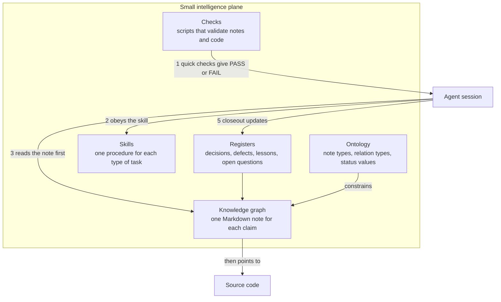
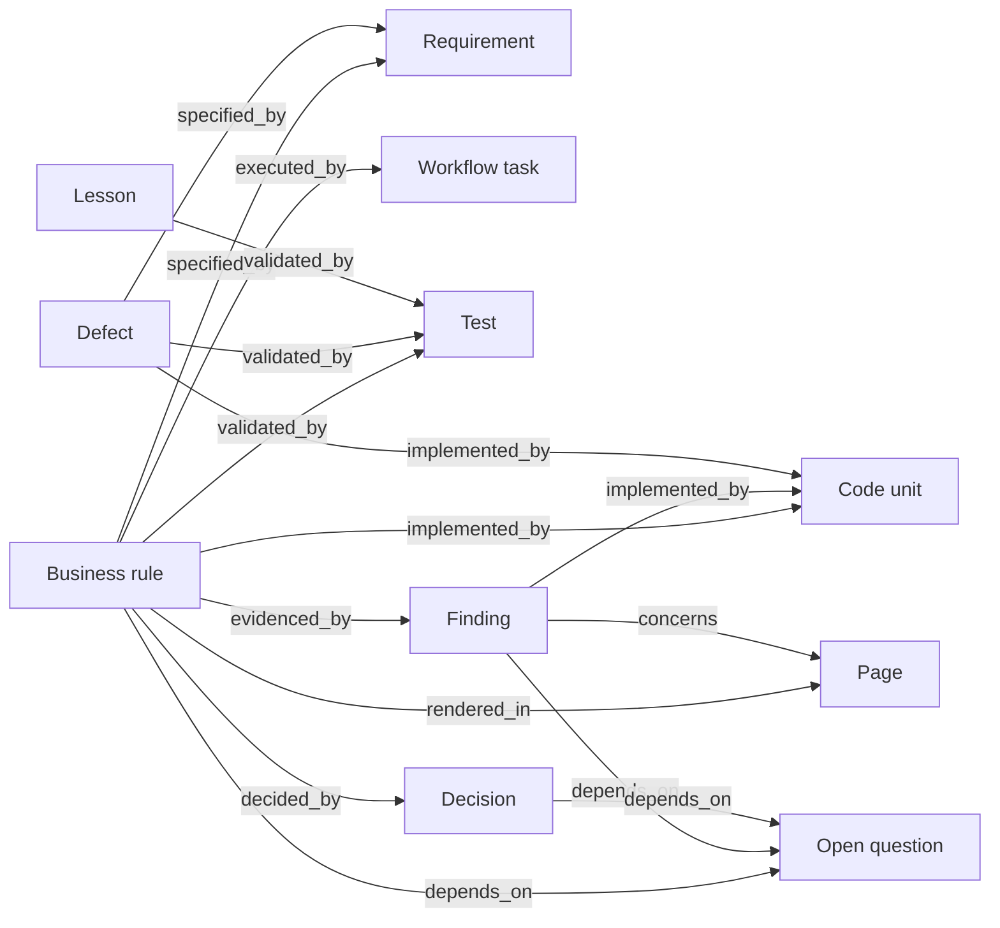
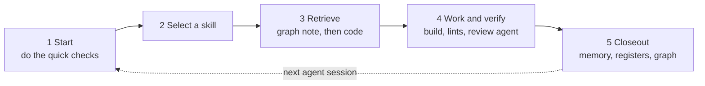
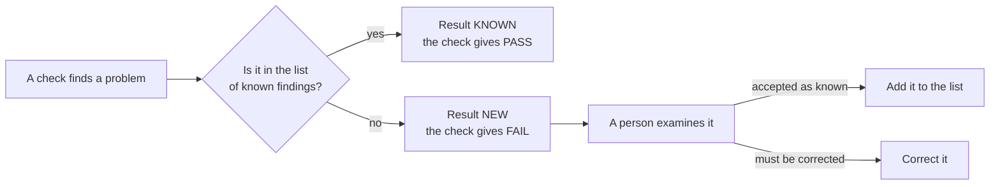

# GE 07 — Case Study — Knowledge Graph for a Legacy Application

> [!abstract] Purpose
> This note shows the three controls on a real project. It shows a small intelligence plane that one developer made with Markdown files.

> [!note] What this note contains
> This note shows a pattern from a real project: the maintenance of a legacy application. It shows only the structure. It contains no business rules, no names and no code from that project. The examples use the game store of [GE 06 — Worked Example — Game Store Software Factory](ge-06-worked-example-game-store-software-factory.md).

## 1. The condition at the start

The application is a legacy enterprise web application. It has a workflow engine, many pages and many business rules. The documents and the code do not always agree.

On such an application, an agent with no structure has these problems:

- It gives different answers to the same question about a rule.
- At the end of each agent session, it loses what it learned.
- It cannot see the difference between a verified fact and a claim with no evidence.
- It reads too much code to find one rule.

## 2. The solution in one diagram



The numbers are the steps of the agent session loop in section 5.

## 3. The ontology

### 3.1 Node types

Each knowledge note is one node. Each node has one type. The graph has some hundreds of nodes. Business rules are the largest group.

| Group | Node types |
|---|---|
| Rules | Business rule, requirement |
| Implementation | Code unit, page, entity |
| Workflow | Task, role, status |
| Evidence | Finding from an audit, defect |
| Knowledge | Decision, pattern, lesson, open question |
| Verification | Test |

### 3.2 Relation types

The graph has nine relation types. Each relation has a direction and a list of permitted target types.



| Relation | Meaning | Most frequent use |
|---|---|---|
| `specified_by` | The document that gives the rule | Business rule to requirement |
| `implemented_by` | The code that does it | Business rule to code unit |
| `rendered_in` | The page that shows it | Business rule to page |
| `executed_by` | The workflow task that does it | Business rule to task |
| `validated_by` | The test that gives the evidence | Defect to test |
| `decided_by` | The decision that selected it | Business rule to decision |
| `evidenced_by` | The finding or defect that is evidence for it | Business rule to finding |
| `concerns` | The page that a finding is about | Finding to page |
| `depends_on` | The question, finding or rule that you must answer first | Business rule to open question |

### 3.3 Status vocabularies

Each node has properties with a fixed list of values. A script rejects a value that is not in the list.

| Property | Question | Permitted values |
|---|---|---|
| `knowledge_class` | Where does this claim come from? | `AUTH`, `OBS`, `LEARNED` |
| `confidence` | How sure is the claim? | `Verified`, `Strong evidence`, `Inferred`, `Unresolved` |
| `audit_status` | What did the last audit find? | `verified`, `partial`, `unclear`, `conflicting`, `missing`, `superseded` |
| `impl_status` | Does the code do what the rule says? | For example: implemented but not verified, partially implemented, contradicts documentation, not found |

The three values of `knowledge_class` have these meanings:

- `AUTH`: the claim comes from an authoritative document.
- `OBS`: the claim comes from an observation of the code or the system.
- `LEARNED`: the claim comes from experience. No business owner gave approval for it.

> [!info] Key idea
> The agent does not make a claim with no evidence. It reads the confidence and the status. A conflict is an explicit node, and you can see it.

## 4. The parts of a node

Each knowledge note has the same structure. The three example notes below are for rule R2 of the game store.

The rule note:

```yaml
---
id: BR-R2
node_type: business_rule
title: "BR-R2 — An order has one refund at most"
knowledge_class: AUTH
confidence: "Strong evidence"
audit_status: partial
impl_status: "IMPLEMENTED BUT NOT VERIFIED"
evidence: "Requirement 'Refunds', section 2; the method RefundService.createRefund"
sources: ["Requirement 'Refunds', section 2"]
relations:
  - "specified_by|REQ-Refunds"
  - "implemented_by|CODE-RefundService"
  - "validated_by|TEST-second-refund"
verified: false
last_verified: 2026-11-07
---
```

The code unit note and the test note:

```yaml
---
id: CODE-RefundService
node_type: code
title: "CODE-RefundService"
knowledge_class: OBS
confidence: "Verified"
---
```

```yaml
---
id: TEST-second-refund
node_type: test
title: "TEST — The service rejects a second refund"
knowledge_class: OBS
confidence: "Verified"
---
```

The body of each note has five sections:

| Section | Content |
|---|---|
| Claim | One claim. One note holds one claim. |
| Details | The conditions for the claim |
| Relations | The relations to other nodes, with the relation type |
| Referenced by | The nodes that point to this node |
| Source | Where the claim comes from |

A relation is a text value with two parts: `"relation_type|TARGET-ID"`. A script can parse it. Thus a script can validate the full graph.

## 5. The agent session loop

Each agent session has the same five steps. This loop is a small execution graph.



| Step | What occurs | Why |
|---|---|---|
| 1 Start | A script does the quick checks | The agent session starts from a known condition |
| 2 Select a skill | The developer selects the procedure for the task | The agent does not make its own procedure |
| 3 Retrieve | The agent reads the graph note first, then the code that the note points to | The agent reads less code and starts from a verified claim |
| 4 Work and verify | The agent does the work. The build, the lints and a review agent examine the work. | The agent does not give approval to its own work |
| 5 Closeout | The agent updates the memory, the registers and the graph | The next agent session starts with what this agent session learned |

### One skill for each type of task

| Type of task | Skill |
|---|---|
| A question about a rule | Answer from the graph, with the evidence |
| "Is this requirement in the code?" | Do an audit of one requirement against the code |
| A new feature or a change | Write a plan for the change with the related rules |
| A defect from a tester | Correct the defect and add the lesson |
| The end of an agent session | Closeout |

A skill is procedural memory. Refer to [GE 03 — Four Types of Graph](ge-03-four-types-of-graph.md).

## 6. The checks

Scripts do most of the checks. A model does not do these checks.

| Check | Who does it | When |
|---|---|---|
| Quick check of the notes and the code | Script | At the start of each agent session |
| Full check | Script | Each week |
| Code lints for known failure patterns | Script | Before a change in a sensitive area |
| Knowledge lints for the graph | Script | Before work on the workflow |
| Change check: did other people change the code? | Script | After a change by a different developer |
| Graph validator: types, relations, targets | Script | After each new version of the graph |
| Audit of one requirement | Agent, with a skill | One each day |

### The baseline of known findings

After a person examines a finding, the finding goes into a list of known findings. A known finding has the result `KNOWN`. It does not cause a FAIL result. Only a new finding causes a FAIL result.



This rule is important for a legacy application. An old code base has many old problems. With a baseline, the checks stay useful: they show only what changed.

## 7. The pattern and the theory

| Idea | In this case study | Enforced by |
|---|---|---|
| Execution graph | The agent session loop of five steps | A person |
| Procedural graph | The skills | An instruction |
| Knowledge graph | The notes and their relations | The graph validator script |
| Ontology | The node types, the relation types and the status vocabularies | The graph validator script |
| Gate | The checks | Scripts |
| Context graph | Not complete. The registers keep decisions and lessons. They do not keep the steps of each run. | An instruction |
| Improvement loop | The closeout step and the weekly full check | A person and scripts |
| Access | A list of protected notes | An instruction |

In this small version, scripts enforce only the checks and the graph validator. A person operates the agent session loop. The skills and the access list are instructions, thus they are suggestions.

The next improvement is clear from the table. Move each row with "An instruction" to code. For example, a deny rule in the harness is the correct solution for access.

## 8. What the structure changes

| Without the structure | With the structure |
|---|---|
| The agent does a search of the code for a rule | The agent starts at the rule note and goes along `implemented_by` |
| The agent writes a claim with no evidence as a fact | Each claim has a confidence value and a source |
| You cannot see a conflict between the document and the code | The conflict is a status value and an open question |
| The agent session loses its knowledge at the end | The closeout step writes the knowledge to the graph |
| "Is it complete?" is an opinion | A check gives PASS or FAIL |

## 9. Procedure: copy the pattern

1. Select one area of your application with many rules.
2. Give five to eight node types. Give each type a short prefix.
3. Give the relation types. Give each relation type a direction and a list of target types.
4. Give the status vocabularies: source, confidence and audit status.
5. Write one note for each claim, with the same structure.
6. Write a validator script for the types, the relations and the targets.
7. Write one skill for each frequent type of task.
8. Add the closeout step. Do it at the end of each agent session.
9. When a failure occurs two times, add a check for it.

> [!warning]
> Do not put personal data, passwords or confidential names in the graph. An agent can copy the content of a note into its output.

> [!tip] Try it
> **Demonstration:** Read the three example notes of section 4. Go from rule R2 to its code unit and to its test.
> **Question:** "In your code base, which fact do you give to the agent again in each session?"

---
Previous: [GE 06 — Worked Example — Game Store Software Factory](ge-06-worked-example-game-store-software-factory.md) · Next: [GE 08 — Glossary, Checklist and Exercises](ge-08-glossary-checklist-and-exercises.md)
