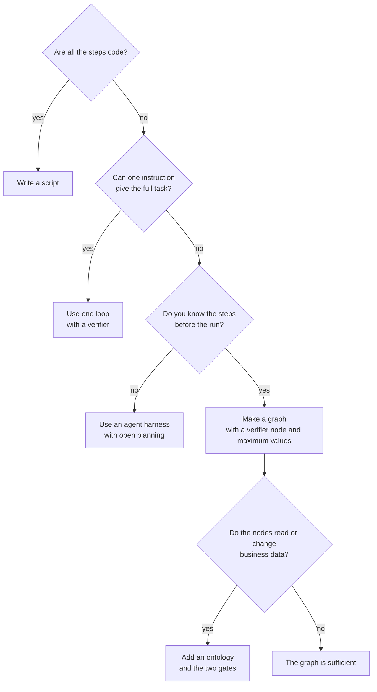

# GE 08 — Glossary, Checklist and Exercises

> [!abstract] Purpose
> Use this note at the end of the session. It gives the terms, a checklist for a design, and exercises.

## 1. Glossary

| Term | Meaning |
|---|---|
| Agent | A model that uses tools in a loop until a task is complete |
| Agent step | A node that contains a full agent |
| Cardinality | The number of items that a relation can have: one, or many |
| Checkpoint | A recorded copy of the state at the end of a node |
| Closeout | The last step of an agent session. It updates the memory and the registers. |
| Conditional edge | An edge where a function or a model selects the next node |
| Constraint | A rule that a value or a relation must obey |
| Context graph | A graph of what occurred in one run: steps, tool calls, records. It is not the context window. |
| Control plane | The layer that manages identity, tool permissions, policies and the audit trail |
| Data plane | The agent runtime: the model calls and the tool calls |
| Edge | A connection that selects the next node in an execution graph |
| Execution graph | The permanent design of nodes and edges in which a system operates |
| Fan-out and fan-in | One node starts two or more nodes at the same time. The branches connect again at one node. |
| Fixed step | A node that contains only code |
| Gate | The point where a check accepts or rejects a result before the next step |
| GraphRAG | Retrieval that uses a knowledge graph. It is about data, not about control. |
| Harness | The code around a model: the tools, the memory, the skills and the files |
| Intelligence plane | The layer that keeps what the system knows, and that makes the system better |
| Knowledge graph | The facts about a domain. The graph keeps them as entities and relations. |
| Loop | A cycle that continues until a stop condition is correct |
| Model step | A node that contains one model call with no tools |
| Neurosymbolic AI | AI that combines a neural model with symbolic rules |
| Node | One unit of work in an execution graph. In a knowledge graph, one entity. |
| Ontology | A formal, shared specification of the types, relations and rules of a domain |
| Procedural graph | The permitted paths of a task. A harness loads it as data. |
| Reasoner | A program that infers new facts from the rules of an ontology |
| Register | A list of items of one type, for example decisions or lessons |
| Semantic layer | The exact definitions of the business terms and metrics |
| Skill | A text file with instructions for one type of task |
| Software factory | A workflow, with agents, that you can do again and again to make software |
| State | The data that moves from node to node |
| System intelligence | What a system of agents can do when it has explicit structure |
| Trace | The record of one run |
| Validator | The function that a gate uses to examine a result |
| Verifier | A node that examines the work of a different node |

Other names for a verifier in the sources: grader, evaluator, reviewer.

## 2. Incorrect ideas

| Incorrect idea | Correct idea |
|---|---|
| "Graph Engineering makes the model deterministic." | The model stays probabilistic. The permitted paths, the values and the checks become fixed. |
| "Temperature zero is sufficient." | A hosted model can give a different output with temperature zero. One different token changes each step that comes after it. |
| "Structured output is sufficient." | A schema controls the shape and the list of values. It does not know the current facts, for example a refund that is in the database. |
| "This is only a workflow engine." | The structure is the same. The difference is that some nodes contain a model or an agent. |
| "Graph Engineering is GraphRAG." | GraphRAG is about data. An execution graph is about control. |
| "More agents give a better result." | More agents give more cost and more points of failure. Add a node only for a specific cause. |
| "A graph replaces the loop." | A loop is one shape of a graph. A loop is frequently one node in a larger graph. |
| "An ontology is a large academic project." | A first ontology is two or three enumerations and three rules in code. |
| "A good prompt is sufficient for a business rule." | A prompt is a suggestion. A gate is a constraint. |
| "If the search finds the record, the answer is correct." | Retrieval and interpretation are different. Do one test for each. |

## 3. Design checklist

### 3.1 Before you make a graph

- [ ] One loop with a strict verifier is not sufficient. You can say why.
- [ ] Each node has one responsibility. You can write it in one sentence with no "and".
- [ ] Each node has a cause: specialization, parallel work, or independent verification.

### 3.2 Nodes and edges

- [ ] Each step that code can do is code.
- [ ] Each rule about approval, cost or safety is a node or an edge, not a sentence in a prompt.
- [ ] The node that examines the work did not write the work.
- [ ] Each cycle has a maximum number of attempts.
- [ ] Each conditional edge records its decision.

### 3.3 State

- [ ] Each field has a type.
- [ ] Each field has one owner.
- [ ] Each field that parallel branches write has a merge rule.
- [ ] The run records a checkpoint at the end of each node.
- [ ] Each node with a side effect is safe to do two times.

### 3.4 Ontology

- [ ] Each field with a fixed list of values is an enumeration.
- [ ] Each relation has a direction and a list of permitted target types.
- [ ] Each of the three errors with the highest cost has a rule.
- [ ] Gate 1 examines the shape of each tool call.
- [ ] Gate 2 examines the sense of each result before a change to data.
- [ ] The agent changes only an isolated copy during the loop, for example a branch. Code commits the result after the gate.

### 3.5 Intelligence plane

- [ ] The domain terms have written definitions.
- [ ] Each claim has a source and a confidence value.
- [ ] The agent has only the permissions that are necessary for the task, and not more than the user has.
- [ ] Each run writes a trace.
- [ ] A person examines the traces at a fixed interval.

## 4. A decision in one diagram

## 5. Four difficult questions

| Question | Answer |
|---|---|
| How do you do a test of a graph? | Do a test of each fixed node and each edge function as for usual code. Replace the model with a fixed result, then do a test of the full path. |
| How does the ontology change? | A change to the ontology is a change request. A person gives approval, and the ontology gets a new version. |
| What is the cost? | Each gate adds time. Each rejected result costs one more model call. Each node adds design work and maintenance. |
| What can you do in the first hour? | Find one rule in one prompt. Move that rule into an enumeration and a validator. Measure the variation before and after. |

For the measurement, use the procedure in [GE 01 — Why Agent Output Changes](ge-01-why-agent-output-changes.md), section 5.

## 6. Exercises

Exercises 1 and 2 are for the session. Exercises 3 to 6 are for the days after the session.

### Exercise 1: give a color to each node (10 minutes)

Use a task that you gave to an agent last week. Write its steps. Give each step a type: code, model, agent or person.

**Result:** a list of steps with a type for each step. Count the steps that code can do.

### Exercise 2: find the suggestions (10 minutes)

Open a system prompt or a skill file that you use. Identify each sentence that is a rule. For each rule, select its correct location: a node, an edge, a gate, or the prompt.

**Result:** a table with two columns: the rule, and its correct location.

### Exercise 3: a first ontology (45 minutes)

Use the procedure in [GE 04 — Ontologies](ge-04-ontologies.md), section 10. Write the ontology of a small domain that you know. A library, a cinema or a car park are good examples.

**Result:** ten nouns, their relations, three enumerations and three rules.

**Check:** write one invalid record for each rule. Make sure that your rule rejects the record.

### Exercise 4: write the two gates (60 minutes)

Write a tool that changes the status of an order. Add Gate 1 with a schema. Add Gate 2 with a validator function. A real model is not necessary. Write three model proposals by hand as JSON objects.

| Proposal | Content | Correct result |
|---|---|---|
| 1 | The amount is the text "ten" | Gate 1 rejects it |
| 2 | The new status is `PROBABLY_SHIPPED` | Gate 1 accepts it. Gate 2 rejects it and gives the cause. |
| 3 | The order goes from `CART` to `REFUNDED` | Gate 1 accepts it. Gate 2 rejects it and gives the cause. |

**Result:** each proposal stops at the correct gate.

### Exercise 5: draw a factory (60 minutes)

Draw the execution graph for one type of change in your own project. Use [GE 06 — Worked Example — Game Store Software Factory](ge-06-worked-example-game-store-software-factory.md) as an example. Write the state contract.

**Result:** a diagram with a color for each node, and a table of fields and owners.

**Check:** each cycle has a maximum. Each field has one owner.

### Exercise 6: one node of a knowledge graph (30 minutes)

Write one note for one business rule of your project. Use the structure in [GE 07 — Case Study — Knowledge Graph for a Legacy Application](ge-07-case-study-knowledge-graph-for-a-legacy-application.md), section 4. Add the relations to the code and to a test.

**Result:** one note that an agent can read before it reads the code.

## 7. Can the learner give the ideas back?

Ask these four questions at the end of the session. Compare each answer with the answer below.

| Question | Answer |
|---|---|
| Why does a graph make a run more predictable? | Code selects the path. The model makes a smaller number of decisions. Each decision is a point where the result can change. |
| Why does an ontology decrease the variation? | It gives the permitted types, values and rules. A gate rejects a result that is not permitted. |
| Why are two gates necessary? | Gate 1 reads only the call. Gate 2 reads the result and the current facts. Some rules must have the current facts. |
| What is the intelligence plane? | The layer that keeps what the system knows. It supplies the rules and the facts for the three controls. |

Then show the diagram "The full system" in [GE 00 — Session Guide](ge-00-session-guide.md). Ask the learner to tell you what each arrow means.

## 8. Questions for discussion

1. Which decision in your system must always be the same?
2. Where is the border between a useful rule and a rule that stops valid work?
3. Who owns the ontology when the business changes?
4. How do you know that a new node made the system better?
5. What does your system know that a competitor with the same model does not know?

## 9. The session in six sentences

1. A model gives a probability, and an agent makes many decisions.
2. In a graph, code selects the path. The model reasons only in a node.
3. The word "graph" has four meanings in these notes: execution, knowledge, context and procedure.
4. An ontology gives the permitted types, values and rules.
5. A gate rejects an incorrect result before it causes a change.
6. The intelligence plane keeps what the system knows and uses each run to make the system better.

---
Previous: [GE 07 — Case Study — Knowledge Graph for a Legacy Application](ge-07-case-study-knowledge-graph-for-a-legacy-application.md) · Start: [GE 00 — Session Guide](ge-00-session-guide.md)
